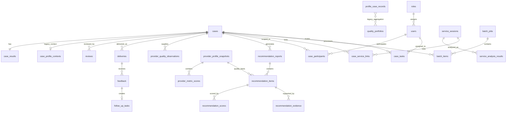

# 众安理赔后医护洞察系统｜数据库设计与实施状态

本文档说明当前 SQLite 数据库的真实结构、各表职责和后续迁移边界。当前设计坚持一个关键原则：**历史病例品质画像与当前案件推荐是两个独立的数据层。画像为推荐提供长期证据，推荐报告是面向某个案件的匹配结果。**

核查日期：2026-10-13。

## 1. 业务数据主线

```text
理赔案件与医疗材料
  → OCR / 结构化 / 痛点 / 温度指引
  → 风险门禁 / 医疗复核 / 模拟触达
  → 用户反馈 / 客服后续处理

历史理赔病例
  → 单病例质量观测
  → 医院 / 医生 / 治疗方案品质指标
  → 品质画像快照
  → 当前患者匹配与推荐评分
  → 推荐报告、推荐项、评分明细、证据链
```

第四问必须保留两套含义不同的指标：

| 层级 | 解决的问题 | 典型维度 |
|---|---|---|
| 品质画像 | 历史病例反映该医院、医生或治疗方案表现如何 | 费用效率、用药合理性、治疗规范性、再入院、患者反馈、数据质量 |
| 推荐匹配 | 某个候选对当前患者是否合适 | 病种匹配、地理便利、专业能力、医生资源、技术能力 |

推荐匹配分不能代替历史品质画像。历史病例不足时，系统可以展示机构公开能力和当前匹配结果，但不能据此生成稳定的医院整体质量结论。

## 2. 数据库与迁移机制

| 项目 | 当前实现 |
|---|---|
| 数据库 | SQLite |
| 默认文件 | `outputs/competition.db` |
| 自定义路径 | 环境变量 `COMPETITION_DB_PATH` |
| 数据访问入口 | `src/medical_claims/storage.py::CaseStorage` |
| 迁移定义 | `src/medical_claims/database_migrations.py` |
| 当前 Schema 版本 | 6 |
| 业务表及迁移表 | 29 张 |
| 外键 | 每个连接执行 `PRAGMA foreign_keys = ON` |

`CaseStorage` 初始化时会执行版本化迁移。每个迁移记录版本、名称、执行时间和校验标识；已执行版本与当前代码不一致时会停止写入，避免数据库在未知结构下继续运行。

### 迁移版本

| 版本 | 内容 |
|---:|---|
| 1 | 保留并兼容原 9 张案件、画像、复核、触达和反馈表 |
| 2 | 用户、角色、权限、案件参与关系，以及案件/复核/触达/反馈的查询字段 |
| 3 | 新品质画像数据层和推荐结果持久化层 |
| 4 | 客服会话、会话分析、案件关联、后续处理扩展和系统日志 |
| 5 | Batch 批次及批次病例持久化表 |
| 6 | 客服跨角色分流任务、目标角色和分流说明 |

## 3. 旧画像表保留原则

以下三张旧表**不得直接删除**：

- `case_profile_contexts`
- `profile_case_records`
- `quality_portfolios`

当前处理规则：

1. 旧表继续存在，旧接口和旧写入路径保持兼容。
2. 新画像表与旧表并行，先验证新链路，再讨论数据迁移。
3. 在旧数据完成映射、双写校验和回滚验证之前，不执行删表或破坏性字段变更。
4. 新推荐报告不能反向冒充或覆盖历史品质画像。

## 4. 表关系概览



## 5. 案件主流程表

| 表 | 作用 | 当前状态 |
|---|---|---|
| `cases` | 案件主表；保存理赔事件、数据来源、授权、脱敏、案件状态和推荐城市 | 已用于主流程 |
| `case_results` | 保存案件最新 OCR、结构化、痛点和温度指引 JSON | 已用于主流程 |
| `reviews` | 保存绑定内容指纹的人工复核决定 | 已用于主流程 |
| `deliveries` | 保存通过风险门禁后的模拟触达记录 | 已用于主流程 |
| `feedback` | 保存用户对触达内容的评价和意见 | 已用于主流程 |
| `follow_up_tasks` | 保存由低分、疑问或会话问题触发的客服后续任务 | 反馈链路已用；客服扩展字段已建表 |

`cases.status` 为兼容旧代码继续保留；`claim_status` 与 `care_status` 分别承载理赔受理状态和关怀服务状态。Schema Version 5 为兼容历史记录保留 `claim_status='COMPLETED'` 的列默认值，但当前运行时新案不会依赖该默认值：客户自助建案显式写入 `PENDING_ACCEPTANCE`，理赔受理或理赔人员绑定已有客户代建后写入 `ACCEPTED`。客户关联同时写入 `cases.customer_user_id` 与有效的 `case_participants(CUSTOMER)`，正式触达必须校验两者一致。

## 6. 旧第四问兼容表

### `case_profile_contexts`

保存旧版画像所需的案件补充上下文，例如确认后的机构、医生、稳定脱敏患者标识、再入院和反馈信息。每个案件最多一条。

### `profile_case_records`

把工作流病例或导入病例组装为旧版 `ProfileCaseRecord`，保存输入、有效记录、组装结果、排除原因和来源类型。该表允许承载不在当前 `cases` 表中的外部历史病例。

### `quality_portfolios`

保存旧版医院、医生和治疗方案的聚合画像快照，包含费用效率、用药合理性、治疗规范性、再入院控制、患者反馈和数据质量等维度。当前固定键 `current` 表示现行聚合快照。

这三张表属于现有可运行能力。在新的观测—指标—画像链路完成业务接入、历史迁移和一致性核验前，它们继续保留。

## 7. 新品质画像数据层

### `provider_quality_observations`

保存从每一份真实历史病例提取出的原子质量观测。它回答“这一病例为某机构、医生或治疗方案的某项质量指标提供了什么事实”。

关键字段：

- `provider_type`：`HOSPITAL`、`DOCTOR` 或 `TREATMENT`
- `provider_id`：机构、医生或治疗方案的稳定标识
- `disease_group`：同病种聚合边界
- `metric_code`：质量指标代码
- `raw_value`、`unit`：原始观测值和单位
- `evidence_json`：可追溯的病例字段或证据
- `source_kind`：工作流病例、历史导入等来源
- `case_id`：必填的来源病例标识；不设外键，因此导入历史样本不要求存在于当前 `cases` 表

该表不保存推荐分，也不因单病例直接形成医院整体质量结论。

### `provider_profile_snapshots`

保存某个“对象 × 病种”的版本化品质画像快照。快照包含样本量、数据充分性、可选综合质量分和完整画像 JSON。

关键约束：同一对象、病种和版本只能有一个快照。旧快照保留，便于审计和比较。

### `provider_metric_scores`

保存画像快照内的逐项质量指标：

- 费用效率
- 用药合理性
- 治疗规范性
- 再入院控制
- 患者反馈
- 数据质量

每项记录分数、样本量、置信度、计算说明、证据和状态。样本不足时使用 `INSUFFICIENT_SAMPLE`，不能伪装成有效分数。

## 8. 推荐结果数据层

### `recommendation_reports`

保存某个案件的一版推荐报告，包括病种、患者推荐城市、状态、规划器版本和完整审计快照。重新生成时版本递增，旧活动版本标记为 `INVALIDATED`。

### `recommendation_items`

保存报告中的医院、医生或治疗方案候选、排名、后端重算总分、置信度和证据状态。

`profile_snapshot_id` 可关联当时使用的品质画像快照。它使评审能够区分：推荐使用了哪个历史画像；若为空，则该候选仅使用机构能力、患者匹配或待核验资料，不能声称拥有历史质量支撑。

### `recommendation_scores`

保存每个推荐项的逐维匹配分、固定权重和理由。它属于当前患者推荐评分，不属于历史质量指标。

### `recommendation_evidence`

保存每条推荐理由的证据来源、链接、摘要、核验状态和置信度。证据状态为：

- `VERIFIED`
- `PARTIALLY_VERIFIED`
- `PENDING_VERIFICATION`
- `CONTRADICTED`

联网超时或暂未找到资料应记录为待核验，不能把候选伪装成已核验；明确事实冲突才标记为冲突。

## 9. 用户、角色与案件范围

| 表 | 作用 |
|---|---|
| `roles` | 定义理赔、医疗复核、客服、用户和系统管理员角色 |
| `permissions` | 定义可授予的操作权限 |
| `role_permissions` | 角色与权限的多对多关系 |
| `users` | 用户基础信息、密码哈希、角色和启停状态 |
| `case_participants` | 限定用户在某个案件中的参与身份和有效期 |

当前已实现本地账号登录、PBKDF2 密码哈希、进程内 Session、角色权限校验和案件参与范围校验。它们适用于单进程比赛原型；生产环境仍需企业统一身份、集中式会话、登录风控和密钥轮换。仓库不预置默认账号或明文密码。

## 10. 客服、会话与审计表

| 表 | 作用 | 当前状态 |
|---|---|---|
| `service_sessions` | 保存脱敏后的客服/微信/在线会话文本及指纹 | Schema 已实现，接口待接入 |
| `service_analysis_results` | 保存会话意图、摩擦点、严重度、证据和建议动作 | Schema 已实现，分析流程待接入 |
| `case_service_links` | 以可审计方法把会话与案件关联 | Schema 已实现，关联流程待接入 |
| `system_logs` | 保存用户、案件、模块、动作和结果审计 | 脱敏确认已接入；其余敏感操作待统一接入 |
| `case_tasks` | 保存客服咨询转交给具体理赔或医疗人员的角色待办 | 理赔与医疗待办已接入；客服类咨询不创建跨角色任务 |

客服会话中的身份信息必须在入库前脱敏。数据库设计不等于自动完成脱敏，调用方仍须执行现有授权和脱敏政策。

## 11. Batch 表

| 表 | 作用 | 当前状态 |
|---|---|---|
| `batch_jobs` | 保存批次名称、创建人、真实汇总状态和计数 | Schema 已实现，当前前端批次尚未切换到表驱动恢复 |
| `batch_items` | 关联批次与独立案件，保存真实状态、错误和重试次数 | Schema 已实现，接口待接入 |

当前 Batch 已按病例创建独立 `case_id` 并运行真实流程；新增表为后续服务端恢复批次准备，不能把表的存在写成前端已经完成持久化恢复。

## 12. 当前实施边界

### 已实现

- 版本化 SQLite migration 和版本校验。
- 原 9 张表原位兼容，不删除数据。
- 用户、角色、权限、案件参与关系的数据结构与基本访问判断。
- 本地账号登录、密码哈希、Session、理赔角色 API 鉴权和案件范围过滤。
- 新品质观测、画像快照和画像指标的读写能力。
- 推荐报告、推荐项、逐维评分和证据的版本化读写能力；MEDICAL 正式推荐流程已接入该持久化层。
- 上游结构化或痛点改变时，按受影响模块执行选择性失效；未受影响结果继续保留。
- 客服、审计和 Batch 的持久化 Schema。
- 客服咨询按问题类型原子分流：医疗、理赔问题进入对应案件负责人的待办，服务问题留在当前客服处理。

### 已验证但仍需业务接入

- 版本 6 迁移可在不覆盖业务记录的前提下新增 `case_tasks` 与咨询分流字段；真实库升级前仍应先做一致性备份。
- 新画像层与推荐层可分别写入，推荐报告不会替代画像。
- 角色权限只有在用户与案件存在有效参与关系时才授予案件访问。

### 尚未完成

- 从现有 `profile_case_records` 批量生成新质量观测和画像快照。
- 新旧画像双写、一致性对账和正式切换。
- 企业统一身份、集中式会话、登录风控和生产级密码策略。
- 客服会话的自动意图分析和外部渠道导入（当前已支持人工登记与确认分流）。
- 当前 Batch 页面与新批次表的服务端恢复接口。
- 删除、留存、归档和数据库级敏感字段加密策略。

## 13. 安全与数据管理

- `outputs/competition.db`、医疗原图、OCR 敏感缓存、身份映射文件和 `.env` 不得提交 Git。
- API Key 不得写入数据库、日志、测试 fixture 或 Markdown。
- 真实病例变更前应使用 SQLite backup API 创建一致性备份。
- 禁止直接手工删表或编辑状态字段；应通过 migration 与 `CaseStorage` 操作。
- 数据库仍是本地比赛原型，不适合作为未经加固的高并发生产数据库。

## 14. 主要代码位置

| 文件 | 作用 |
|---|---|
| `src/medical_claims/database_migrations.py` | 版本化表结构、数据兼容和种子权限 |
| `src/medical_claims/storage.py` | 事务、案件、画像、推荐、复核、触达与反馈读写 |
| `src/medical_claims/profile_records.py` | 旧画像上下文和病例记录组装 |
| `src/medical_claims/quality_models.py` | 旧版品质画像和 portfolio 模型 |
| `src/medical_claims/quality_phase1_models.py` | 第四问 V2 能力画像和推荐模型 |
| `web/backend/app.py` | 当前 API 入口 |
| `tests/test_database_design.py` | 迁移、旧表保留、权限、画像/推荐分层回归测试 |

## 15. 一句话理解重点表

| 表 | 一句话作用 |
|---|---|
| `profile_case_records` | 保留现有单病例画像输入和组装结果 |
| `quality_portfolios` | 保留现有医院、医生、方案的聚合品质画像 |
| `provider_quality_observations` | 保存每个历史病例贡献的原子质量事实 |
| `provider_profile_snapshots` | 保存某对象在某病种下的一版品质画像 |
| `provider_metric_scores` | 保存画像中的费用、用药、规范性、再入院、反馈等质量指标 |
| `recommendation_reports` | 保存针对当前案件生成的一版推荐输出 |
| `recommendation_items` | 保存医院、医生和治疗方案候选及排序 |
| `recommendation_scores` | 保存当前患者匹配评分，不冒充历史品质指标 |
| `recommendation_evidence` | 保存每条推荐理由可追溯的证据链 |

## 16. MEDICAL 正式编排如何使用现有表

医疗复核编排继续复用既有结果与审核表；Schema Version 6 为跨角色分流新增 `case_tasks` 及咨询去向字段，Schema Version 7 将“客服本人”分流补齐为可领取、可解决的任务：

- `structured_effective_result` 是读取时将原结构化结果与最新字段复核决定叠加得到的有效视图，不是新增数据库列，也不会覆盖模型原始提取值。
- 字段级复核与模块级复核继续写入 `reviews`，通过 `target_type` 区分结构化字段、痛点、温度指引、本次就医品质评价、推荐和组合触达。
- 模块生成状态、输入指纹和失效记录使用现有结果表与 `system_logs` 留痕。结构化字段修正后，仅将依赖该字段的下游模块标记为 `STALE` 或失效。
- 本次病例六维品质观察写入 `provider_quality_observations`；它是病例级观察，不能直接宣称医院整体质量。
- V2 推荐正式结果写入 `recommendation_reports`、`recommendation_items`、`recommendation_scores` 和 `recommendation_evidence`，并保留版本、评分及证据链。
- 旧画像兼容三表继续保留；新 MEDICAL 编排不会删除或覆盖其历史数据。

正式主链为：理赔人员移交医护关怀 → 分配有效 `MEDICAL_REVIEWER` → 医疗人员准备各分析模块 → 分模块复核 → 组合触达门禁。CUSTOMER 和 SERVICE 仍使用同一案件、参与关系、触达、反馈与跟进数据。
