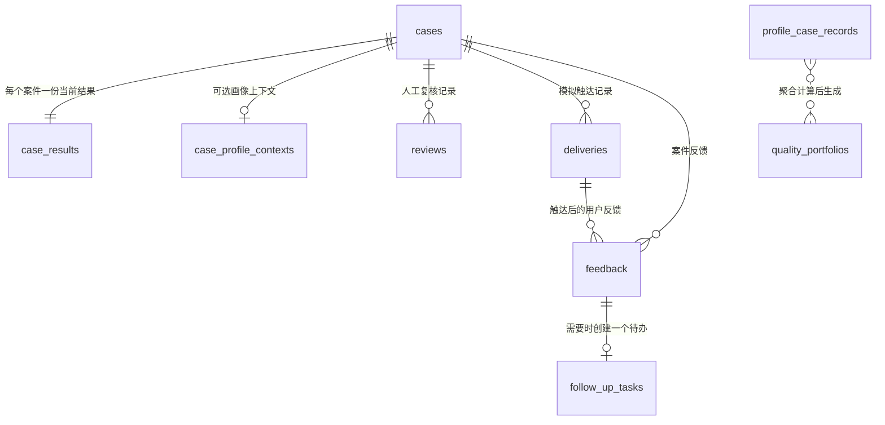

# 当前数据库说明

本文档依据当前代码和本地 SQLite 实际结构整理，方便团队理解数据存在哪里、每张表承担什么职责，以及修改数据库时需要注意哪些关联关系。

核查时间：2026-10-09。

## 1. 数据库概览

项目使用 Python 内置的 **SQLite**，不需要单独安装或启动数据库服务。

| 项目 | 当前实现 |
|---|---|
| 默认数据库文件 | `outputs/competition.db` |
| 自定义路径 | 环境变量 `COMPETITION_DB_PATH` |
| 建表位置 | `src/medical_claims/storage.py::CaseStorage.__init__` |
| 连接方式 | 每次操作创建短连接，事务完成后关闭 |
| 外键 | 每个连接执行 `PRAGMA foreign_keys = ON` |
| 当前业务表数量 | 9 张 |
| 当前库文件大小 | 约 4.84 MiB |
| Schema 迁移机制 | 暂无；启动时使用 `CREATE TABLE IF NOT EXISTS` |
| 数据版本/事件溯源 | 暂无独立版本表或事件表 |

默认数据库位于 `outputs/`，该目录已被 Git 忽略。数据库可能包含 OCR 文本、结构化病历和反馈内容，禁止提交到 Git 或对外分享。

## 2. 表关系



需要特别注意：

- `cases` 是案件主表，`case_results` 是该案件的当前 OCR、结构化、痛点和温度指引结果。
- `case_profile_contexts`、`reviews`、`deliveries`、`feedback`、`follow_up_tasks` 通过外键关联当前案件。
- `profile_case_records` 同时支持当前工作流案件和外部历史病例导入，因此没有强制关联 `cases`。
- `quality_portfolios` 保存全局聚合结果，目前只有固定键 `current`，不是按案件分别保存。
- 外键没有配置级联删除；当前也没有正式的数据删除 API。

## 3. 当前数据快照

以下数量来自本地 `outputs/competition.db` 的只读统计，仅表示 2026-10-09 核查时的工程数据状态，不代表正式比赛样本量或医学评测结果。

| 表 | 当前记录数 |
|---|---:|
| `cases` | 11 |
| `case_results` | 11 |
| `case_profile_contexts` | 0 |
| `profile_case_records` | 0 |
| `quality_portfolios` | 1 |
| `reviews` | 2 |
| `deliveries` | 1 |
| `feedback` | 1 |
| `follow_up_tasks` | 0 |

记录数量会随着页面操作、Batch、测试或脚本运行而变化。存在一条 `quality_portfolios` 记录不等于已有足够的画像病例，也不表示第四问指标已经达标。

## 4. 各表作用与字段

### 4.1 `cases`：案件主表

**作用**

保存案件身份、来源、授权状态、脱敏状态和当前工作流状态。页面切换案件、判断能否调用外部模型、控制触达流程时都会读取该表。

创建案件时，系统同时在 `case_results` 中创建一条空结果记录。

| 字段 | 类型 | 约束 | 说明 |
|---|---|---|---|
| `case_id` | TEXT | 主键 | 系统生成的 UUID，也是全流程案件标识 |
| `claim_event_id` | TEXT | 非空 | 理赔事件或业务入口标识；当前原型由请求提供 |
| `status` | TEXT | 非空 | 当前工作流状态 |
| `data_source` | TEXT | 非空 | 数据来源声明，例如用户上传或官方脱敏数据 |
| `consent_status` | TEXT | 非空 | 授权状态；外部模型和画像入库会检查是否为 `authorized` |
| `deidentification_status` | TEXT | 非空 | 脱敏状态；相关流程会检查是否为 `confirmed` |
| `created_at` | TEXT | 非空 | UTC ISO 时间 |
| `updated_at` | TEXT | 非空 | 最近状态或结果更新时间 |

当前状态值定义在 `workflow_models.py::WorkflowStatus`：

`RECEIVED` → `PROCESSING` → `STRUCTURED` → `PAIN_READY` → `CARE_READY`，之后可能进入 `DELIVERY_READY`、`REVIEW_REQUIRED`、`APPROVED`、`REJECTED`、`BLOCKED`、`DELIVERED_MOCK`、`FEEDBACK_RECEIVED`、`FOLLOWUP_PENDING` 或 `RESOLVED`。

### 4.2 `case_results`：前三问当前结果表

**作用**

保存单个案件最新一次的 OCR、结构化病历、痛点报告和温度指引。该表保存的是当前快照，不保留每次生成的历史版本。

| 字段 | 类型 | 约束 | 说明 |
|---|---|---|---|
| `case_id` | TEXT | 主键、外键 → `cases.case_id` | 与案件一对一 |
| `ocr_result_json` | TEXT | 可空 | 多份 OCR 文档、页码、文本块、置信度和 bbox 等 JSON |
| `structured_result_json` | TEXT | 可空 | `ClaimCase` 结构化病例 JSON，含诊断、手术、用药、检查、费用和事件等 |
| `pain_result_json` | TEXT | 可空 | `PainPointReport` JSON |
| `care_result_json` | TEXT | 可空 | `CareGuideReport` JSON |
| `updated_at` | TEXT | 非空 | 结果最近更新时间 |

**失效规则**

- 重新保存结构化病例时，会清空旧的痛点和温度指引。
- 重新保存痛点报告时，会清空旧的温度指引。
- 结构化结果或痛点结果与请求中的对象不一致时，后端拒绝继续保存下游结果，防止旧页面覆盖新案件状态。
- OCR 原始图片本身不保存在 SQLite；保存的是 OCR 结果 JSON。

### 4.3 `case_profile_contexts`：案件画像补充上下文表

**作用**

保存第四问旧版历史画像组装所需的人工确认信息。它用于确认医院/医生来源，以及补充再入院和反馈字段，并不保存第四问 V2 的完整推荐结果。

| 字段 | 类型 | 约束 | 说明 |
|---|---|---|---|
| `case_id` | TEXT | 主键、外键 → `cases.case_id` | 每个案件最多一条上下文 |
| `context_json` | TEXT | 非空 | `CaseProfileContextRequest` JSON |
| `updated_at` | TEXT | 非空 | 最近更新时间 |

`context_json` 主要包括：

- 已确认的医院上下文；
- 已确认医生 ID；
- 稳定脱敏患者 token；
- 30 天内再入院标签；
- 患者反馈评分。

若填写再入院标签，代码要求同时提供稳定脱敏患者 token。重新结构化病例时，该表对应案件的数据会被清除。

### 4.4 `profile_case_records`：画像聚合病例记录表

**作用**

把结构化病例、痛点、已确认机构/医生和其他补充信息组装成第四问旧版质量画像引擎可以聚合的 `ProfileCaseRecord`。

该表可保存两类来源：

- `workflow`：从当前案件工作流生成；
- `imported`：从历史病例导入。

| 字段 | 类型 | 约束 | 说明 |
|---|---|---|---|
| `case_id` | TEXT | 主键 | 病例标识；历史导入记录不要求存在于 `cases` |
| `input_json` | TEXT | 非空 | 完整 `ProfileRecordInput`，用于重建与变更比较 |
| `record_json` | TEXT | 可空 | 通过校验后形成的 `ProfileCaseRecord`；无法组装时为空 |
| `assembly_json` | TEXT | 非空 | `ProfileAssembly`，包含组装结果及排除/缺失原因 |
| `source_kind` | TEXT | 非空 | `workflow` 或 `imported` |
| `updated_at` | TEXT | 非空 | 最近更新时间 |

一条病例记录可能包含医院伪匿名 ID、病种组、医生伪匿名 ID、治疗方案 ID、费用、住院、用药复核信号、再入院和反馈等画像输入。

保存内容变化时，系统删除 `quality_portfolios`，要求重新聚合，避免旧画像继续使用。

### 4.5 `quality_portfolios`：旧版聚合品质画像表

**作用**

保存旧版质量画像引擎对 `profile_case_records` 聚合后的 `QualityPortfolio`。其中可以包含医院、医生和治疗方案画像及六类质量维度。

| 字段 | 类型 | 约束 | 说明 |
|---|---|---|---|
| `portfolio_key` | TEXT | 主键 | 当前固定为 `current` |
| `portfolio_json` | TEXT | 非空 | 完整 `QualityPortfolio` JSON |
| `updated_at` | TEXT | 非空 | 最近构建时间 |

`portfolio_json` 主要包含：

- 医院、医生、治疗方案画像列表；
- 费用效率、用药合理性、治疗规范性、再入院控制、患者反馈和数据质量等维度；
- 样本量、分数、置信度、证据字段、限制和推荐资格；
- 病例数、机构数、医生数、治疗方案数和最低样本门槛。

该表是全局当前聚合快照，不保存历史版本。当前新版第四问 V2 的 DeepSeek 候选、联网证据状态和最终页面结果没有写入此表。

### 4.6 `reviews`：人工复核记录表

**作用**

保存对某一版待触达内容的人工审核决定。审核记录绑定 `content_fingerprint`，案件内容变化后，旧审核不能批准新内容。

| 字段 | 类型 | 约束 | 说明 |
|---|---|---|---|
| `review_id` | TEXT | 主键 | 审核 UUID |
| `case_id` | TEXT | 外键 → `cases.case_id` | 所属案件 |
| `content_fingerprint` | TEXT | 非空 | 当前触达快照的 SHA-256 指纹 |
| `target_type` | TEXT | 非空 | `care_guide`、`recommendation` 或 `combined_delivery` |
| `decision` | TEXT | 非空 | `APPROVED` 或 `REJECTED` |
| `record_json` | TEXT | 非空 | 完整 `ReviewRecord`，含审核人和备注 |
| `created_at` | TEXT | 非空 | 审核时间 |

安全规则：只有 `REVIEW_REQUIRED` 内容可以提交审核；明确 `BLOCKED` 的内容不能通过人工批准绕过。

### 4.7 `deliveries`：模拟触达记录表

**作用**

保存通过风险门禁后的模拟网页收件箱触达。当前没有真实短信、APP 或企业微信发送。

| 字段 | 类型 | 约束 | 说明 |
|---|---|---|---|
| `delivery_id` | TEXT | 主键 | 触达 UUID |
| `case_id` | TEXT | 外键 → `cases.case_id` | 所属案件 |
| `content_fingerprint` | TEXT | 非空 | 被发送内容的快照指纹 |
| `record_json` | TEXT | 非空 | 完整 `DeliveryRecord` JSON |
| `created_at` | TEXT | 非空 | 触达时间 |

唯一约束：`(case_id, content_fingerprint)`。同一案件的同一版内容不能重复生成多条触达记录。

`record_json` 包括模拟渠道、自动/人工批准模式、风险门禁结果、是否包含推荐、温度指引和推荐内容快照。

### 4.8 `feedback`：用户反馈表

**作用**

保存用户对温度指引、推荐或整体服务的评分与意见。每条反馈必须关联一次已存在的触达。

| 字段 | 类型 | 约束 | 说明 |
|---|---|---|---|
| `feedback_id` | TEXT | 主键 | 反馈 UUID |
| `delivery_id` | TEXT | 外键 → `deliveries.delivery_id` | 对应触达 |
| `case_id` | TEXT | 外键 → `cases.case_id` | 所属案件 |
| `record_json` | TEXT | 非空 | 完整 `FeedbackRecord` JSON |
| `created_at` | TEXT | 非空 | 提交时间 |

`record_json` 包括反馈对象、1–5 分评分、是否有帮助、反馈类别和评论。

如果本次触达没有包含推荐，后端不允许提交“推荐结果”反馈。

### 4.9 `follow_up_tasks`：反馈后续处理待办表

**作用**

把需要人工跟进的反馈转换为后续处理任务。当前规则为：评分不高于 3 分、认为无帮助，或反馈类别不是 `clear` 时创建待办。

| 字段 | 类型 | 约束 | 说明 |
|---|---|---|---|
| `task_id` | TEXT | 主键 | 待办 UUID |
| `case_id` | TEXT | 外键 → `cases.case_id` | 所属案件 |
| `feedback_id` | TEXT | 唯一、外键 → `feedback.feedback_id` | 每条反馈最多创建一个待办 |
| `status` | TEXT | 非空 | `OPEN` 或 `RESOLVED` |
| `record_json` | TEXT | 非空 | 完整 `FollowUpTask` JSON |
| `created_at` | TEXT | 非空 | 创建时间 |

解决待办时，系统更新 `record_json` 中的处理结论和解决时间；如果案件已没有其他开放待办，案件状态进入 `RESOLVED`。

## 5. 数据写入主线

```text
创建案件
  → cases
  → case_results（同步创建空行）

OCR / 结构化 / 痛点 / 温度指引
  → case_results
  → 同步更新 cases.status

确认医院、医生、再入院和反馈上下文
  → case_profile_contexts
  → profile_case_records
  → quality_portfolios（重新构建后写入）

风险准备与人工审核
  → reviews

模拟触达
  → deliveries

用户反馈
  → feedback
  → follow_up_tasks（符合规则时）
```

Batch 没有单独的批次表。当前批次信息和进度由前端运行时维护；每个病例子目录自动创建独立 `case_id`，最终仍写入 `cases` 和 `case_results` 等现有表。

## 6. 不在 SQLite 中的数据

以下内容使用文件或运行时状态保存，不能通过查询 `competition.db` 获得：

| 数据 | 当前位置/方式 | 说明 |
|---|---|---|
| 原始上传图片 | 请求处理过程 | SQLite 不保存原图 |
| 长病例分块缓存 | `outputs/_long_case_cache/` | JSON 缓存，用于避免重复结构化调用 |
| 第四问可信机构能力缓存 | `outputs/provider_capability_cache.json` 等 | 医院/医生公开能力和证据缓存，不是 SQLite 表 |
| 第四问 V2 当前推荐结果 | API 请求时计算并返回 | 当前没有独立推荐结果表 |
| Batch 批次状态 | 浏览器前端运行时 | 没有 `batches` 或 `batch_items` 表 |
| 评测结果和审计报告 | `outputs/` 下 JSON/Markdown | 不写入业务数据库 |
| OCR 原图到脱敏标识的私有映射/HMAC 材料 | `work/` 下受控文件 | 不属于业务表，禁止提交 |

## 7. 当前设计优点

- 数据库无需独立服务，适合比赛原型和单机演示。
- 全流程使用同一个 `case_id`，案件、审核、触达和反馈关系清晰。
- 上游结果变化会使部分下游数据失效，能够降低旧结果串案风险。
- 触达使用内容指纹，避免旧审核和重复发送。
- JSON 列可以完整保存 Pydantic 模型，开发迭代较快。

## 8. 当前限制与修改注意事项

1. **没有正式迁移系统。** 新增或修改字段不能只改 `CREATE TABLE IF NOT EXISTS`，已有数据库不会自动获得新的列。后续应引入版本化 migration。
2. **JSON 字段难以直接查询。** 诊断、药品、费用和推荐证据都封装在 JSON 中，适合原型保存，不适合复杂统计和多人并发业务。
3. **没有历史版本。** `case_results` 和 `quality_portfolios` 只保存当前快照，重新生成会覆盖旧结果。
4. **第四问 V2 尚未正式持久化。** 当前候选、评分、医生和联网证据主要由 API 计算及 JSON 缓存提供。
5. **Batch 尚无后端批次表。** 浏览器刷新后无法仅靠数据库恢复完整批次进度和批次元数据。
6. **删除与留存能力缺失。** 当前没有用户删除、按期限清理、级联删除和正式审计日志。
7. **访问控制不足。** SQLite 是本地单库，没有用户、角色、租户和行级权限表。
8. **敏感数据未做数据库级加密。** 结构化病例和 OCR 文本以 JSON 文本存储，应依赖受控目录权限；生产环境需要加密、密钥管理和访问审计。
9. **并发能力有限。** 写操作使用事务和部分 `BEGIN IMMEDIATE` 防止竞态，但 SQLite 不适合作为高并发生产数据库。
10. **不要直接手工改库。** 状态、指纹和下游失效有配套逻辑，应通过 `CaseStorage` 或 API 操作。

## 9. 主要代码位置

| 文件 | 作用 |
|---|---|
| `src/medical_claims/storage.py` | 建表、事务、案件结果、画像、审核、触达、反馈和待办的统一读写 |
| `src/medical_claims/workflow_models.py` | 案件字段和工作流状态 |
| `src/medical_claims/profile_records.py` | 画像上下文、历史病例输入与画像病例组装 |
| `src/medical_claims/quality_models.py` | 旧版画像、portfolio 和推荐数据模型 |
| `src/medical_claims/review_models.py` | 人工复核模型 |
| `src/medical_claims/delivery.py` | 风险门禁后的触达内容与记录 |
| `src/medical_claims/feedback_models.py` | 用户反馈和后续处理待办模型 |
| `src/medical_claims/quality_integration.py` | 当前案件、画像病例和旧版 portfolio 的连接逻辑 |
| `web/backend/app.py` | 对外 API 与 `CaseStorage` 调用入口 |

## 10. 一句话理解每张表

| 表 | 一句话作用 |
|---|---|
| `cases` | 案件是谁、从哪里来、是否授权脱敏、当前走到哪一步 |
| `case_results` | 该案件当前最新的 OCR、结构化、痛点和温度指引 |
| `case_profile_contexts` | 为旧版第四问人工确认医院/医生并补充画像上下文 |
| `profile_case_records` | 把单病例转换成可供历史画像聚合的标准记录 |
| `quality_portfolios` | 保存旧版医院/医生/治疗方案聚合画像快照 |
| `reviews` | 保存针对具体内容版本的人工通过或驳回决定 |
| `deliveries` | 保存经过风险门禁后实际执行的模拟触达 |
| `feedback` | 保存用户对已触达内容的评分和意见 |
| `follow_up_tasks` | 把低分或有疑问的反馈转成可处理的后续待办 |
