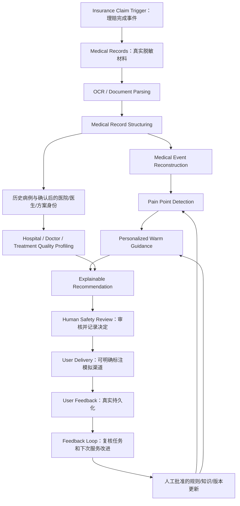
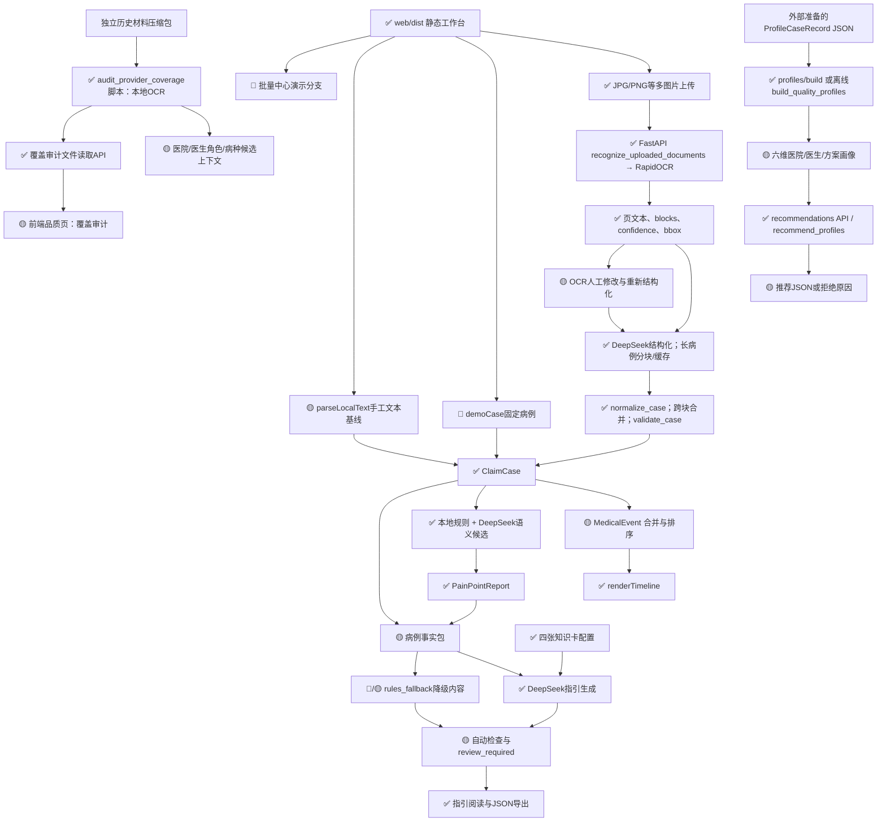
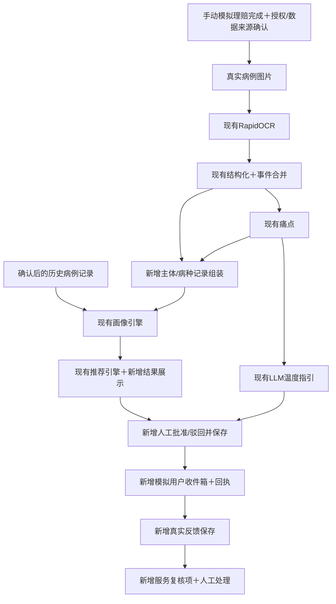
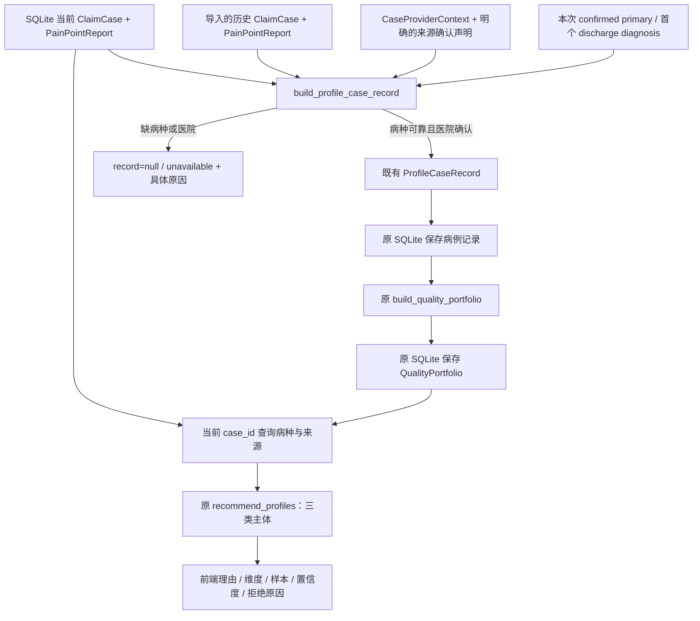
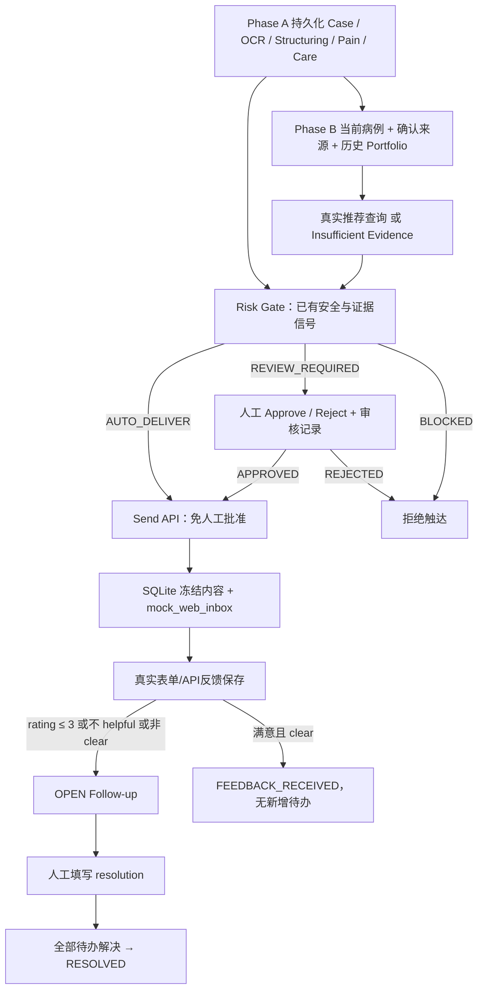

# Project Completion Map

核对日期：2026-10-06。项目：基于理赔医护记录的“医护洞察与温度指引”引擎。

本文件回答“已有系统如何成为功能完整的比赛原型”，不展开 bug、评分算法修复、提示词优化或重构。本次只新增本文件。功能存在、主流程接通、数据可用、指标达标是四个不同状态，不能互相替代。

结论：前三项已有真实调用链，第四项已有独立计算引擎；主要缺少案件级连接、画像数据组装与展示、可保存的审核决定、触达、反馈及反馈消费。按第 4 节的功能覆盖权重估计整体约 52%，不是比赛得分或准确率。OCR 不需要重新寻找；画像和推荐不需要从零开发。

检查范围：README、全部业务源码、web/backend、web/dist（包括默认搜索会忽略的 dist）、docs、tests、evaluation、knowledge、examples、scripts、配置及 API 路由。额外检查本地 outputs 文件的结构和数量；不把 .venv 第三方依赖当项目业务代码，不读取密钥内容。没有独立 frontend/backend/configs 目录，其对应实现位于 web 与 pyproject.toml。未启动额外服务或运行外部模型；用户日志已经证明本地后端和静态网页启动成功，但不证明全部业务步骤成功。

当前本地 outputs 有七份同一 case_id 的长病例分块 JSON 缓存，包含非空结构化字段。不能仅根据案件号或缓存断言来源、官方标注质量或最终全案成功。没有找到正式 gold、痛点专家标注、指引盲评结果或画像覆盖报告实物。文档中的 70 案件/728 图片、42 页运行记录作为历史记载，不能代替本次可核验数据。

## 1. Competition Target System

最终产品是理赔后的关怀与就医辅助原型：收到理赔事件与医疗材料，理解本次就医过程，识别可解释痛点，生成病例专属指引，使用历史脱敏病例构建品质画像并给出推荐，在明确安全和授权边界后触达用户，保存反馈并进入后续服务改进。

依据：[命题文档](</D:/yiliao/medical-track-task-4-2/AI Coding大赛命题详情介绍.docx>)，其中 KR1–KR5、方案完整性和可落地性要求。文档同时明确以“方案 + 原型演示”为主，不要求完整工程化上线。



画像是历史病例批量聚合的旁路，不是仅凭当前一名患者就能生成医院品质分数。当前患者的病种及需求用于查询已有画像和选择推荐；只有具备合格历史记录才能建立比较。

| 范围 | 定位 | 最小可交付解释 |
|---|---|---|
| 理赔触发、材料入口、结构化、事件重建 | Must Have | 原型事件可模拟，医疗材料和处理必须真实；有对应理赔审核系统接口方案 |
| 三维痛点、≥5类、证据与严重度 | Must Have | 真实检测与专家标注验证，不要求实现题目每个举例 |
| ≥3病种的个性化指引、六个板块 | Must Have | LLM 病例理解与个性化生成；不能仅靠降级模板 |
| 医院/医生/治疗方案画像、≥5维、可解释推荐 | Must Have | KR4 明确列为目标；不能因为“加分项”也提到画像就忽略该 KR |
| ≥3病种×每病种≥5机构、每项推荐≥2理由 | Must Have | 用真实数据验证覆盖；不能用合成医院满足正式覆盖 |
| 触达与反馈、合规路径、用户授权范围 | Must Have | 可采用模拟渠道加真实反馈保存；说明何时推送、反馈如何回流 |
| 三个外部系统对接方案 | Must Have | 理赔审核、客服工单、医疗资源推荐：事件、数据、回执和失败处理 |
| KR1–KR3 正式效果验证、资源成本估算 | Must Have | 最终提交必须有结果；这一轮只规划缺失交付物，不修评测代码 |
| 可保存的人工审核与发布门禁 | Should Have；本最小方案采用 | 命题未指定必须有独立“医生审批系统”；为安全演示设一个简单审核步骤即可，不扩展为医院工作流 |
| 反馈生成内部服务复核任务 | Should Have | 最小反馈回流落地；命题不要求在线自动训练 |
| 多格式自动转换 | Should Have，按验收数据需要 | 医疗文档理解是要求，不意味着必须同时原生支持 JPG/PDF/Word/TXT/JSON 全格式 |
| 慢病长期管理、复诊提醒、依从性管理 | Bonus | 命题明确加分项，不影响基础闭环成立 |
| 跨病种推荐、异常模式变异识别 | Bonus | 当前同病种推荐可以作为基础，跨病种与变异免疫后续做 |
| 真短信/企微/APP SDK、生产 HA、自动微调、复杂权限平台 | 不需要在收尾阶段做 | 原型加接口方案已满足工程深度定位，不要求商业上线 |

完整可提交还必须满足：KR1 F1≥0.90、关键字段缺失率<5%；KR2专家一致率≥85%；KR3温度感及可行动性≥4/5；KR4维度与覆盖；KR5全链路和合规方案。功能完整后才进入验证这些阈值的阶段，不能先宣称达标。

## 2. Current System Architecture

图中只放当前存在的代码。不存在的流程在图后标 ❌，不伪装成当前节点。✅ 表示存在可调用实现，🟡 表示功能或集成仅部分完成，🧪 表示演示/测试分支；不表示指标已达标。



当前断点：❌ 理赔事件入口/持久化案件流程；❌ 当前病例自动组装画像记录；❌ 工作台画像与推荐结果展示；❌ 审核决定与发布状态保存；❌ 触达适配器；❌ 用户反馈存储与消费。

真实网页调用链位于 [app.py](</D:/yiliao/medical-track-task-4-2/web/backend/app.py>) 与 [app.js](</D:/yiliao/medical-track-task-4-2/web/dist/app.js>)。独立 [ClaimPipeline.process](</D:/yiliao/medical-track-task-4-2/src/medical_claims/pipeline.py>) 和 [Provider 抽象接口](</D:/yiliao/medical-track-task-4-2/src/medical_claims/providers.py>) 没有作为网页生产调用链使用；测试里有 Fake Provider。静态站点部署配置和本地启动脚本存在，服务器启动不等于理赔流程闭环。

实际 API 清单：

| Route | 函数 | 功能 |
|---|---|---|
| GET /api/health | health | 本地依赖/配置状态 |
| POST /api/cases/process | process_case | 多图片→ClaimCase |
| POST /api/cases/process-detailed | process_case_detailed | ClaimCase＋逐页OCR文本 |
| POST /api/cases/restructure-from-ocr | restructure_case_from_ocr | 修正文本重新抽取 |
| POST /api/cases/analyze-pain-points | analyze_case_pain_points | 病例→痛点 |
| POST /api/cases/generate-care-guide | generate_case_care_guide | 病例＋痛点→指引 |
| GET /api/quality/audit-summary | get_quality_audit_summary | 读取独立机构覆盖报告 |
| POST /api/quality/profiles/build | build_quality_profiles | 标准病例记录→画像 |
| POST /api/quality/recommendations | get_quality_recommendations | 画像→推荐 |

没有发现 review decision、delivery、feedback、claim trigger 或统一 workflow 路由。

## 3. Module-by-Module Status

### 3.1 Input / Medical Document

| 格式 | 真实支持 | 入口与边界 |
|---|---|---|
| JPG/JPEG | 是 | UploadFile→本地OCR |
| PNG | 是 | 同上 |
| BMP/WebP | 是 | 后端白名单支持；前端 image/* 可选 |
| PDF | 否 | 前端 fileInput 显示可选，后端没有PDF解析实现 |
| Word/DOCX | 否 | 没有业务上传解析器；本仓库命题 DOCX 不是被系统解析的患者输入 |
| TXT | 文件上传不支持 | 手工编辑 OCR 文本及文本请求支持，不等于 TXT 文件解析 |
| JSON | 下游结构化请求、评测导入支持 | ClaimCase 可以直接送痛点/指引API；没有通用原始病历JSON导入/解析功能 |

同案多图片输入有实现；原型暂不需要为每一种文件格式新建解析器。依据：[recognize_uploaded_documents](</D:/yiliao/medical-track-task-4-2/web/backend/app.py:177>)、[fileInput](</D:/yiliao/medical-track-task-4-2/web/dist/index.html:42>)、app.js 的 addFiles、parseLocalText、readJsonFile。

### 3.2 OCR

✅ 真实 OCR 已实现，使用 RapidOCR，onnxruntime 为运行依赖。输入是本地图片路径；上传接口先将图片写临时目录。输出 document_id、page、full_text、blocks[]；每个 block 有 text、confidence 和 bbox。bbox 由识别多边形的最小/最大坐标转换。逐页文本也有人工修正标记。

调用链：process_case_detailed→recognize_uploaded_documents→recognize_image→get_ocr_engine→RapidOCR。不是仅存在于测试。另有历史材料审计脚本使用同种 OCR。

**不需要重新寻找 OCR。** 收尾目标是复用现有图片OCR与修正文本文档；PDF 分页支持仅在实际材料需要时补充。字段 evidence 的 bbox 是另一个绑定层，不能因 OCR 有框就宣称所有医学字段有准确框。

依据：[app.py:129–177 对应函数](</D:/yiliao/medical-track-task-4-2/web/backend/app.py:129>)、[pyproject.toml](</D:/yiliao/medical-track-task-4-2/pyproject.toml>)、[audit_provider_coverage.cached_ocr](</D:/yiliao/medical-track-task-4-2/scripts/audit_provider_coverage.py:84>)。

### 3.3 Medical Structuring

✅ 存在真实模型结构化实现：逐页 OCR 文本＋页码/文件编号＋页平均置信度→DeepSeek JSON Schema 请求→Pydantic ClaimCase→本地规范化/校验。长病例另外分块、合并和缓存。hybrid 为 OCR＋LLM＋规则后处理，没有已接入的独立医学 NLP 模型。

| 数据 | 当前字段 |
|---|---|
| diagnosis | name、code、diagnosis_type、certainty |
| procedure | name、performed_date、body_site、is_historical |
| medication | name、dose、frequency、route、duration、usage_condition、max_daily_dose、additional_instructions |
| hospitalization | admission_date、discharge_date、length_of_stay_days、department |
| examination | category（检验/影像/病理/功能等）、name、performed_date、results（名称/值/单位/参考范围/异常标记）、conclusion |
| cost | 总额、目录内外、基金支付、个人自付/自费/负担、账户/现金渠道、比例、分类金额、勾稽 |
| events | event_type、event_time、description、related_entity_ids |
| evidence | document_id、page、text、可选bbox |
| confidence | 字段级 FieldValue 与事件 confidence |

FieldValue 还包含 normalized_value、status、warnings、derivation。字段状态区分已提取、推导、不适用、材料未提供、冲突、需复核。缺少专门患者恢复阶段、原文出院行动/预约实体以及案件结果持久化层。

依据：[models.py 的 ClaimCase/FieldValue](</D:/yiliao/medical-track-task-4-2/src/medical_claims/models.py>)、[structure_with_deepseek](</D:/yiliao/medical-track-task-4-2/web/backend/app.py:247>)、[normalize_case](</D:/yiliao/medical-track-task-4-2/src/medical_claims/normalization.py:265>)、[validate_case](</D:/yiliao/medical-track-task-4-2/src/medical_claims/validation.py:16>)。

### 3.4 Medical Event Reconstruction

🟡 完成度约65%。有 MedicalEvent 数据和真实前端 timeline；不是仅静态图。

- 模型在结构化时生成事件日期/描述/证据；event_time 允许为空，前端显示“时间待确认”，不是把所有事件都补成真实日期。
- 同一 case_id 的多份文档可共同结构化；同一住院不同材料可以合并。
- 长病例 merge_claim_cases 合并事件，_merge_events 按类型/时间/描述去重，按时间排序；_rebuild_event_links 关联实体。
- DiagnosisType.HISTORY、Procedure.is_historical 提供部分历史区分；Medication、Examination、MedicalEvent 没有统一历史/本次阶段标记。
- 一个 ClaimCase 只有一个 hospitalization 对象；没有完整多次就诊分组与跨案件纵向患者时间线。

需要保留现有事件能力，不必重写 timeline。最小版本可限定一次理赔对应一次主要就诊，历史事实保留历史标记/人工确认，不承诺跨年健康档案。

依据：[MedicalEvent](</D:/yiliao/medical-track-task-4-2/src/medical_claims/models.py:233>)、[long_case._merge_events/_rebuild_event_links](</D:/yiliao/medical-track-task-4-2/src/medical_claims/long_case.py:464>)、[renderTimeline](</D:/yiliao/medical-track-task-4-2/web/dist/app.js:355>)。

### 3.5 Pain Point Detection

✅ 有检测逻辑，不只是枚举。

| 维度 | 痛点 | 当前执行逻辑 |
|---|---|---|
| Clinical | 用药与诊断关系待医学复核 | semantic_pain_points_with_deepseek 生成候选；_sanitize_semantic_points 检查类型、证据及具体药品/诊断路径 |
| Clinical | 重复药品记录待复核 | _duplicate_medications 对医嘱场景同名药品分组，给复核提示 |
| Clinical | 异常检查随访关注 | _abnormal_examinations、_is_verified_abnormal 用异常标记、原文/参考范围判定，再按检查主题聚合 |
| Cost | 目录外自费比例偏高 | _cost_ratio_points 计算明确金额/比例并按阈值触发 |
| Cost | 个人负担比例偏高 | 同函数，区分自付/自费与支付渠道 |
| Cost | 费用勾稽差异 | _reconciliation_point 消费费用校验结果 |
| Experience | 诊断术语难理解 | _jargon_points 使用术语词表/长度；也接受LLM候选 |
| Experience | 用药说明不完整 | _missing_medication_instructions 检查医嘱剂量/频次/途径/疗程；费用清单不直接视为医嘱 |
| Experience | 康复/随访指导不完整 | LLM语义候选，提示词限制为材料明确指导不具体的情境；无专用确定性规则 |

输入 ClaimCase；输出 PainPointReport：三维汇总和逐条 type、title、severity、severity_score、confidence、description、evidence、related_fields、recommended_action、review_required、detector。

LLM不可用时运行确定性规则；用药-诊断和指导完整性等语义能力并非规则独立完成。重复检查、非必要检查和完整临床路径知识推理未实现，但命题的举例不要求全部补齐。下一阶段核心是使用现有类别完成真实标注验证。

依据：[pain_rules.detect_rule_pain_points及各函数](</D:/yiliao/medical-track-task-4-2/src/medical_claims/pain_rules.py>)、[pain_engine.analyze_pain_points](</D:/yiliao/medical-track-task-4-2/src/medical_claims/pain_engine.py:254>)、[语义候选函数](</D:/yiliao/medical-track-task-4-2/web/backend/app.py:476>)、[pain_models.PainPoint](</D:/yiliao/medical-track-task-4-2/src/medical_claims/pain_models.py:49>)。

### 3.6 Warm Guidance

✅ 病例事实包＋痛点＋知识卡→LLM草稿→自动检查→CareGuideReport，已接网页。

输入包含诊断名称、操作名称、药品及剂量/频次/途径/疗程、住院日期/LOS、部分费用、检查结论、pain points 和质量标记。不是只传病名。没有专门恢复阶段输入，事件时间线和完整出院医嘱不是事实包的独立部分。

| 命题要求 | 当前输出 |
|---|---|
| diagnosis explanation | diagnosis_explanation |
| treatment review | treatment_review |
| cost explanation | cost_explanation |
| recovery plan | recovery_plan[]：action/timing/reason |
| emotional support | opening＋psychological_support |
| next visit recommendation | follow_up_plan[]；属于复诊沟通行动，不是医院排行榜 |

另有 red_flags、limitations、safety_checks、knowledge_review_status、review_required、evidence_coverage 和 generation_method。LLM主路径有个性化机制；rules_fallback 是固定内容加事实的降级分支，不能用它证明非模板化生成。

知识卡已有肺炎、骨折、糖尿病、肺结节；四份JSON登记为 reviewed。README仍有“草稿”描述，以当前JSON为准。知识卡审核记录不等于每份患者指引已人工审核。

依据：[care_prompt.build_case_fact_pack](</D:/yiliao/medical-track-task-4-2/src/medical_claims/care_prompt.py:25>)、[CareGuideDraft/Report](</D:/yiliao/medical-track-task-4-2/src/medical_claims/care_models.py:42>)、[care_guide_with_deepseek](</D:/yiliao/medical-track-task-4-2/web/backend/app.py:522>)、[care_engine](</D:/yiliao/medical-track-task-4-2/src/medical_claims/care_engine.py>)、[知识卡](</D:/yiliao/medical-track-task-4-2/knowledge/care_guides>)。

### 3.7 Quality Profiling

🟡 **医院、医生、治疗方案三种画像均有真正计算代码，但尚未形成当前病例→画像的主流程。**

build_quality_portfolio 按“主体类型＋主体ID＋病种”分组，同一 _profile 函数为三种主体计算指标：

| 画像 | 主体数据 | 当前边界 |
|---|---|---|
| Hospital Profile | institution_id＋disease_group | 需要独立机构上下文及人工确认，不在ClaimCase中 |
| Doctor Profile | clinician_ids＋disease_group | 身份审计有经治/主治/手术等角色；聚合输入仍需组装合格ID |
| Treatment Profile | treatment_plan_id，或由手术/药名组合hash生成 | 是病例组合聚合标识，不是临床路径知识库或规范方案定义 |

输入 ProfileCaseRecord：ClaimCase、institution_id、disease_group、clinician_ids、可选treatment_plan_id、可选stable_patient_token/readmitted_within_30_days、可选patient_feedback_score、可选PainPointReport。

| 维度 | 函数与实际计算 | 所需数据 | 现状 |
|---|---|---|---|
| 费用效率 | _cost_metric：病例费用中位数相对同病种费用的反向百分位；有LOS时日均费用 | 费用＋LOS＋同病种样本 | 有代码，没有本次可核验的正式聚合结果 |
| 用药合理性 | _medication_metric：按用药关系/重复用药复核痛点严重分扣分，再求均值 | 用药＋PainPointReport | 是风险筛查代理，不是药师处方点评 |
| 治疗记录规范性 | _standardization_metric：诊断/日期/医嘱/事件证据完整度加权 | ClaimCase | 记录规范性代理，不是真正指南依从性 |
| 30日再入院控制 | _readmission_metric：100×(1−输入再入院标签均值) | 稳定患者token＋已知30日标签 | 有计算接口，没有自动跨就诊关联产生标签 |
| 患者反馈 | _feedback_metric：输入5分制均值/5×100 | patient_feedback_score | 消费外部评分；没有收集接口 |
| 数据质量 | _data_quality_metric：字段confidence均值与quality_flags | ClaimCase | 数据可信度，不是医疗疗效 |

**是真实确定性计算，非LLM自由评分，也不是固定医院排行榜。** 固定权重/公式是模型设计参数，与mock结果不同。数据不足时返回 data_unavailable / insufficient_sample，不能将六个维度槽位都当作已有六项有效品质证据。

数据来源链分开存在：audit_provider_coverage 从历史图片提主体上下文；病例结构化与痛点API产出病例；build_quality_profiles.py 读取人工/外部准备的标准记录。缺少join器把这些产物按case_id拼成有效记录并保存。前端仅接 audit-summary，不调用 profiles/build。

依据：[quality_engine.build_quality_portfolio/_profile/derive_treatment_plan_id](</D:/yiliao/medical-track-task-4-2/src/medical_claims/quality_engine.py>)、[ProfileCaseRecord](</D:/yiliao/medical-track-task-4-2/src/medical_claims/quality_models.py:69>)、[provider_extraction.build_safe_context](</D:/yiliao/medical-track-task-4-2/src/medical_claims/provider_extraction.py:224>)、[build_quality_profiles.main](</D:/yiliao/medical-track-task-4-2/scripts/build_quality_profiles.py>)、[renderQualityAudit/loadQualityAudit](</D:/yiliao/medical-track-task-4-2/web/dist/app.js:757>)。

### 3.8 Recommendation

🟡 有确定性推荐引擎，尚未接前端推荐展示。

- 支持 institution、clinician、treatment_plan 三种entity_type，分别是医院、医生、方案组合推荐。
- 当前按同一disease_group筛选，按综合分/置信度/样本量排序，非跨病种推荐。
- 默认画像主体至少3样本，至少3个可计算且样本达标维度才生成综合分；推荐资格另有confidence门槛。
- 每条RecommendationItem至少两条reasons。reasons来自非data_quality的可计算维度，含分数、样本量、公式与evidence_fields。
- evidence是字段路径级依据，不是推荐理由直接附原文span或样本病例ID集合。
- 不足时返回空推荐及warnings，已有拒绝推荐能力。
- 工作台“品质推荐”目前实际展示机构覆盖审计和准备状态，不能看到RecommendationReport结果。

依据：[recommend_profiles](</D:/yiliao/medical-track-task-4-2/src/medical_claims/quality_engine.py:424>)、[RecommendationItem/Reason](</D:/yiliao/medical-track-task-4-2/src/medical_claims/quality_models.py:115>)、[get_quality_recommendations](</D:/yiliao/medical-track-task-4-2/web/backend/app.py:782>)、[app.js.loadQualityAudit](</D:/yiliao/medical-track-task-4-2/web/dist/app.js:800>)。

### 3.9 Human Review

🟡 有审核标记、知识卡审核记录、OCR人工修正，没有完整审核决定工作流。

| 能力 | 实际存在情况 |
|---|---|
| review_required | 病例字段、痛点、指引、机构/医生候选均有标记 |
| 自动安全检查 | validate_care_guide / finalize_care_guide 产出check状态 |
| 人工OCR修正 | 有网页编辑、保存当前页、重新结构化API；是文本纠正，不是指引发布审批 |
| 知识卡医学审核 | JSON有reviewer/reviewed_at/review_status |
| 机构人工复核清单 | 审计脚本输出private review queue；没有通用review API |
| 每份指引/推荐批准或驳回 | Missing：没有决定记录、审核人、时间、绑定版本的持久化流程 |
| 医生审核系统 | Missing：没有医生身份认证或医生审批入口；不能把自动passed当医生批准 |
| 发布gate | 缺少已批准版本才可触达的案件级流程 |

最小版本用团队医学复核者登记决定，不必另建医院医生账号平台。说明审核者身份，不能把医学学生人工复核描述成临床医生正式签发。

依据：[care_models](</D:/yiliao/medical-track-task-4-2/src/medical_claims/care_models.py>)、[care_engine.finalize_care_guide](</D:/yiliao/medical-track-task-4-2/src/medical_claims/care_engine.py:206>)、[app.js.restructureFromCorrectedOcr](</D:/yiliao/medical-track-task-4-2/web/dist/app.js:465>)、[机构审核说明](</D:/yiliao/medical-track-task-4-2/docs/fourth-question-provider-audit.md>)。

### 3.10 Delivery

❌ 没有APP、SMS、企业微信、客服工单发送接口；没有DeliveryProvider、mock delivery、delivery记录或触达状态流程。现有renderCareReport是在操作员工作台展示，不是理赔后向指定用户推送；JSON下载也不是发送回执。

最小新增一种 simulated_web_inbox：批准后创建delivery_id，保存channel=mock、目标伪匿名用户、已批准报告版本、时间和模拟回执；用户页可以打开该已发布内容。明确模拟，不能宣称短信已送达。

依据：[app.py全路由](</D:/yiliao/medical-track-task-4-2/web/backend/app.py>)、[renderCareReport/exportCareReport](</D:/yiliao/medical-track-task-4-2/web/dist/app.js:672>)。

### 3.11 Feedback

❌ 没有用户评分、care guide反馈、推荐反馈的提交API、表单或持久化存储。

ProfileCaseRecord.patient_feedback_score 是外部输入槽位；CareRating 是线下盲评输入模型。两者均不能当作在线用户反馈模块。浏览器localStorage只保存后端地址，病例与报告主要在内存；没有feedback表。

最小反馈关联delivery_id/case_id/report_version，包含服务对象（care/recommendation）、评分、是否有帮助、可选问题分类与备注、提交时间。服务关怀评分不直接冒充医院品质反馈；医院品质评分须明确指向机构及评价含义。

依据：[ProfileCaseRecord](</D:/yiliao/medical-track-task-4-2/src/medical_claims/quality_models.py:69>)、[CareRating](</D:/yiliao/medical-track-task-4-2/src/medical_claims/care_evaluation.py:15>)、[app.js](</D:/yiliao/medical-track-task-4-2/web/dist/app.js>)。

### 3.12 Feedback Loop

❌ 执行代码Missing；作为未来服务优化方向标记Planned，尚无完整专项方案。

没有反馈消费者、复核任务产生、推荐重算触发、prompt版本更新或模型训练。_feedback_metric 可以消费调用者提供的评分，但没有从用户提交→保存→聚合的连接。

最短回流：用户反馈保存→分类→生成/更新一个待处理服务复核项→人工记录处理结果→必要时重新生成一个新版本；由人批准后再触达。反馈汇总可供下一轮规则/知识/推荐设计参考。无需自动更新prompt或在线训练；患者个体反馈不能未经审查直接改变医疗结论。

### 3.13 Compliance

| 项目 | 状态 | 真实范围 |
|---|---|---|
| 医院/医生伪匿名 | Implemented，独立审计路径 | pseudonymous_id使用HMAC；真实映射留private，公开上下文仅编号 |
| 患者标识移除 | Missing | 上传OCR文本没有已实现的患者姓名/证件/联系方式剥离层 |
| 脱敏输入要求 | Documentation Only | README、页面和人工清单要求材料脱敏，没有输入状态执行机制 |
| consent | Missing | 无授权声明/范围/版本/撤回记录 |
| authorization | 部分Implemented / Documentation Only | LLM API Key用于供应商鉴权；不是患者授权，也不是用户角色权限系统 |
| external LLM protection | Partially Implemented | 本地OCR、只发文本、指引事实包、后端密钥；不能因此认定文本已脱敏 |
| logging | Implemented，基础技术日志 | logger和异常日志存在；不是授权/审核/触达/反馈审计日志 |
| 原图临时文件清理 | Implemented | TemporaryDirectory退出清理上传临时图 |
| retention | Missing（持久数据策略） | 分块缓存和private缓存无完整保留期管理 |
| deletion | Missing（案件删除/撤回） | 无案件删除API及关联报告/反馈删除流程 |
| Git隔离 | Implemented | .gitignore忽略.env、outputs、work；忽略规则不是访问控制 |

依据：[post_deepseek/_chunk_cache_path/process_case_detailed](</D:/yiliao/medical-track-task-4-2/web/backend/app.py>)、[provider_extraction.pseudonymous_id](</D:/yiliao/medical-track-task-4-2/src/medical_claims/provider_extraction.py:204>)、[audit_provider_coverage](</D:/yiliao/medical-track-task-4-2/scripts/audit_provider_coverage.py>)、[.gitignore](</D:/yiliao/medical-track-task-4-2/.gitignore>)、[人工任务清单](</D:/yiliao/medical-track-task-4-2/docs/third-question-manual-checklist.md>)。

最小比赛要求是清楚的数据合规路径与授权范围，不等于必须上线完整隐私平台。新增服务存储和触达时至少需要记录授权/数据来源确认、外发边界和人工清理办法；更完整删除API可后续做。

### 3.14 Evaluation

| KR | 已有代码 | 可评什么 | 本次找到的实际数据 |
|---|---|---|---|
| KR1 Structured F1 | evaluation.evaluate；前端runEvaluation | 字段Precision/Recall/F1及missing_rate | 七份结构化分块缓存，不是gold/正式成绩；没有最终专家gold |
| KR2 Pain Point Agreement | pain_evaluation.evaluate_pain_points | 标签P/R/F1、Jaccard式expert_agreement、severity一致率 | 空gold模板与测试构造数据；未见独立专家标注 |
| KR3 Warmth | care_evaluation.evaluate_care_ratings | 温度、行动性、个性化、清晰度、事实/安全错误汇总 | 评分模板与人工清单；未见真实盲评分数 |
| KR4 Recommendation | 机构审计report requirement_check、quality单测 | 候选病种×机构覆盖、推荐至少两理由/不足拒绝的局部测试 | 没有画像记录/组合/真实推荐报告；没有端到端KR4验收runner |

12个测试文件、52个test方法主要覆盖Schema、规则、归并和局部编排。Fake Provider是测试替身，不是线上OCR。test_quality_engine使用构造记录验证推荐机制，不是官方数据品质证明。未找到LLM-as-judge；命题需要人工盲评，不必为此新增judge模型。

结论：评测程序基础已存在，正式评测数据和可复现验收包未齐备。当前不能证明KR1–KR4达标。这一轮不讨论算法口径修复，只记录交付物缺失。

依据：[evaluation.py](</D:/yiliao/medical-track-task-4-2/src/medical_claims/evaluation.py>)、[pain_evaluation.py](</D:/yiliao/medical-track-task-4-2/src/medical_claims/pain_evaluation.py>)、[care_evaluation.py](</D:/yiliao/medical-track-task-4-2/src/medical_claims/care_evaluation.py>)、[test_quality_engine.py](</D:/yiliao/medical-track-task-4-2/tests/test_quality_engine.py>)、[examples](</D:/yiliao/medical-track-task-4-2/examples>)、[evaluation/templates](</D:/yiliao/medical-track-task-4-2/evaluation/templates>)。

## 4. Completion Matrix

Completion是功能覆盖和可接入程度的估计，不扣这一轮排除的具体bug分，也不等于指标成绩。已有主实现但缺集成/数据通常50–85%；仅标记/说明约20–40%；无代码0%。权重只为明确“整体约52%”计算方式，是工程判断，不是主办方评分。

| Module | Required by Competition | Current Status | Completion | Weight | Main Gap |
|---|---|---|---:|---:|---|
| Claim Trigger / Workflow | Yes | ❌ Missing | 0% | 8 | 理赔事件、统一案件状态、关联产物保存 |
| Input | Yes；非全格式必须 | ✅ 图片Implemented | 85% | 4 | 受支持格式契约，持久文档索引 |
| OCR | Yes（图片材料） | ✅ Implemented | 90% | 7 | OCR结果与案件长期关联；可选PDF分页 |
| Structuring | Yes | ✅ 核心Implemented | 80% | 12 | 案件级存储与正式输出管理 |
| Event Timeline | Yes | 🟡 Partial | 65% | 5 | 统一历史/本次语义，非多次就诊系统 |
| Pain Detection | Yes | ✅ 核心Implemented | 80% | 10 | 独立标注与正式数据验证 |
| Warm Guidance | Yes | ✅ 核心Implemented | 75% | 10 | 病例版本、恢复/医嘱事实、正式三病种验证 |
| Quality Profile | Yes | 🟡 引擎有、集成缺 | 55% | 10 | 标准记录组装、确认主体、真实数据、≥5维证据 |
| Recommendation | Yes | 🟡 引擎有、展示缺 | 55% | 7 | 当前病例查询、结果展示、覆盖验证 |
| Human Review | Should Have；本最小方案采用 | 🟡 标记＋OCR纠正 | 25% | 7 | 指引/推荐审批记录、发布状态 |
| Delivery | Yes | ❌ Missing | 0% | 5 | 一种模拟渠道与可保存回执 |
| Feedback | Yes | ❌ Missing | 0% | 5 | 用户输入表单、API、存储 |
| Feedback Loop | Yes（机制）；自动学习非必须 | ❌ Missing / Planned | 0% | 3 | 至少反馈消费与服务复核任务 |
| Compliance | Yes | 🟡 Partial | 35% | 4 | 授权范围、患者文本边界、留存说明 |
| Evaluation | Yes | 🟡 程序有、证据缺 | 40% | 3 | 独立gold/盲评、KR4报告、验收清单 |

加权结果51.75%，约52%。研发代码主体明显超过一半，但“用户得到关怀并能反馈”的后半链路尚未形成；因此不能用前三项代码数量估计整个产品完成度。

## 5. Missing Features

### Must Finish

1. **理赔触发与案件产物连接。** 一个手动模拟claim_completed事件入口即可；保存case_id、材料索引、各模块结果ID和状态。当前上传按钮不代表保险理赔事件。
2. **画像数据桥接与历史样本集。** 把确认后的主体上下文＋ClaimCase＋痛点按case_id组装ProfileCaseRecord，调用已有引擎；不重写算法。缺少病种×机构真实覆盖数据必须列为外部依赖。
3. **推荐结果接主流程。** 当前患者病种→既有portfolio→三种entity_type结果/拒绝原因→可读展示与两条理由。
4. **至少一种触达演示和反馈保存。** 模拟渠道明确标识；反馈必须真实持久化，重启后能读取。
5. **可说明的反馈回流。** 反馈进入客服/医学服务复核项，有处理记录；不要求自动训练或自动改推荐。
6. **合规及三系统接口方案。** 说明授权范围、脱敏责任、LLM外发、留存/清理、理赔/客服/资源推荐对接和资源估算。
7. **正式验收交付物。** 独立标注、盲评原始记录、KR4覆盖与画像理由报告。现在准备数据组织和模板，下一轮再修复/评测。

KR4必须有至少5个有定义的数据支持维度。现有六槽位中再入院/反馈缺数据时不能伪造；需要从主办方提供的资源取得真实标签/反馈，或由医学成员定义现有医疗记录可支持且经说明认可的替代维度。替代维度是否符合评审口径应明确确认。没有第五维或覆盖数据，最小链路可完成，但不能称KR4达标。

### Should Finish

1. **人工审核决定与发布gate。** 是本最小路径采用的安全支撑模块；保存审核者/时间/版本/批准或驳回，连到触达。
2. **推荐依据关联原始样本。** 现有字段路径/公式可解释，进一步关联样本ID方便展示。
3. **恢复阶段和出院行动结构化。** 让现有指引消费病例原文医嘱；不是增加新病种或新模型。
4. **结果版本与重启恢复。** 最小SQLite足够，不必任务平台；已发送内容不受后续重生成覆盖。

### Optional

- PDF分页或Word/TXT解析，按真实验收材料需求决定。
- 提醒、依从性或长期管理，是加分项。
- 真短信/企微渠道、跨病种推荐、异常模式监测，基础闭环成立后考虑。

## 6. Minimum Complete Version

目标：复用现有引擎，加一条案件连接与持久化链路，用一个已声明模拟的触达渠道收集真实反馈。最小完整链路不等于指标已经达标。



| 步骤 | 当前是否已有 | 缺什么 | 最小新增 | 涉及文件（现有/拟新增） | 工作量 |
|---|---|---|---|---|---|
| 理赔触发 | 无 | 案件入口、授权确认、流程关联 | 手动claim_completed请求，保存event_id/case_id和授权/官方脱敏来源确认 | app.py；新增workflow_models.py、workflow.py、storage.py | Medium |
| 真实病例输入 | 图片入口有 | 案件文档与产物索引 | 复用上传，保存材料编号/顺序与案件关联 | app.py、storage.py | Small |
| OCR | 有 | 结果可恢复关联 | 复用recognize_image，把OCR结果绑定case_id | app.py、storage.py | Small |
| 结构化/事件 | 有 | 全案结果版本保存 | 保存ClaimCase及结果版本；采用一次主要就诊范围 | app.py、workflow.py、storage.py | Small |
| 痛点 | 有 | 案件状态串联 | 保存PainPointReport并记录输入结构化版本 | app.py、workflow.py、storage.py | Small |
| 温度指引 | 有 | 报告版本和后续交付关联 | 保存CareGuideReport，默认草稿，绑定病例/痛点版本 | app.py、workflow.py、storage.py | Small |
| 品质画像 | 独立引擎有 | join与真实历史记录 | 复用主体提取/审核上下文，组装ProfileCaseRecord，调用build_quality_portfolio | 新增profile_records.py；provider_models.py、quality_models.py、build_quality_profiles.py | Medium（数据准备可能Large） |
| 可解释推荐 | 引擎有 | 患者病种查询和展示 | 调用recommend_profiles；显示三主体结果/不可用、两理由、样本量和限制 | app.py、web/dist/app.js、index.html | Medium |
| 人工复核 | 标记/OCR纠正有 | 最终决定保存 | 单一复核表单；review_id/report_version/审核人/结论/备注/时间 | 新增review_models.py；app.py、storage.py、app.js、index.html | Medium |
| 模拟触达 | 无 | 渠道契约、发布记录 | DeliveryProvider抽象＋MockWebInbox；生成delivery_id并保存模拟回执 | 新增delivery.py；app.py、storage.py、app.js、index.html | Medium |
| 真实反馈 | 输入评分槽位有，收集无 | 提交与持久化 | feedback API、简单表单、SQLite；按care/recommendation分对象 | 新增feedback_models.py、feedback.py；app.py、storage.py、前端 | Medium |
| 反馈消费 | 无 | 有动作的回流 | 反馈生成服务复核项；人工处理/再生成后形成新版本 | feedback.py、workflow.py、storage.py、前端 | Small–Medium |
| 合规与接口说明 | 零散说明 | 全路径约定 | 一份接口/数据责任说明及来源授权记录；定义清理办法 | 新增docs/competition-integration.md；workflow_models.py | Small–Medium |
| 验收数据组织 | 代码/模板有 | 正式数据与KR4结构检查 | 结果清单、标注/评分包、维度/覆盖/两理由检查报告 | evaluation模板；新增scripts/check_competition_coverage.py | Medium（医学标注Large） |

推荐存储选择：SQLite一个本地文件，保存案件、报告版本、主体确认、审核决定、模拟触达、反馈、复核任务。原图可以继续临时处理；数据存储放被Git忽略目录，建立清理约定。没有必要引入PostgreSQL/Redis/Celery。

最小状态建议：received→structured→pain_ready→care_ready→recommendation_ready（允许明确拒绝结果）→pending_review→approved/rejected→delivered_mock→feedback_received→followup_pending/resolved。该状态机是拟新增，不是当前已有。

反馈最小回流验证：一条“不理解费用解释”的真实用户反馈，重启后仍可读；后台出现对应服务复核项；复核者记录“需补解释/无需修改”，必要时生成新报告版本。证明反馈被消费即可，不要求本轮改prompt或自动学模型。

拒绝推荐是合法安全路径，但正式KR4仍需在真实可用数据上展示合格画像与推荐，不能全靠拒绝输出交差。三主体可以显示可用/不足；尤其医生数据不足时应明确，不得编造医生。

## 7. Implementation Order

1. **确定最小输入与数据范围。** 保留图片路径，采用一次案件一次主要就诊；清点授权真实历史材料、现有产物、病种×机构与可用维度。数据不足先记录外部依赖。
2. **建立案件/报告最小存储与事件入口。** 保存伪匿名case_id、理赔事件、材料索引、授权/来源确认、版本和状态。后面所有模块按这个ID连接。
3. **把现有前三项结果接到存储。** 复用当前函数，逐步保存结构化/事件、痛点和指引；不改模型、不重构Provider。
4. **增加主体确认与ProfileCaseRecord组装。** 从现有独立审计产物和前三项结果join；只纳入确认主体。构建历史portfolio并保存。
5. **接推荐接口与结果阅读。** 当前病种查询已保存画像；展示真实结果或拒绝原因，理由可回到维度与公式。
6. **增加人工审核决定。** 操作员查看指引/推荐，复核者批准或驳回，保存版本；未经批准不得进入触达流程。
7. **增加模拟触达。** 只发布批准版本，创建可访问用户收件箱及明确模拟回执。
8. **增加反馈保存与消费。** 用户提交评价/问题，存储后生成复核项；人工处理记录完成最小回流。
9. **补系统接口和合规交付。** 理赔事件、客服复核项、资源推荐查询，各有输入输出与失败处理；记录触达时点和资源估算。
10. **检查功能闭环DoD。** 跑真实病例到真实保存反馈，重启后可追溯；同时准备三病种和KR4数据清单。通过后再进入下一轮bug修复、效果评测和比赛优化。

建议分工：A负责结果存储接入、主体记录组装与算法接口；B负责状态流程、审核/触达/反馈API及页面接线；C确认医学主体、维度含义、材料范围、审核内容及标注/盲评组织。按功能分工，不需要多智能体实现。

## 8. Files That Will Need Changes

以下仅为预计修改范围，尚未修改。拟新增文件可按实现规模合并，避免为每个概念制造独立服务。

| 文件 | 预期用途 |
|---|---|
| [web/backend/app.py](</D:/yiliao/medical-track-task-4-2/web/backend/app.py>) | 加案件事件/查询、审核、触达、反馈路由；复用现有业务函数 |
| [web/dist/app.js](</D:/yiliao/medical-track-task-4-2/web/dist/app.js>) | 连接案件状态、画像推荐、审核决定、用户收件箱和反馈 |
| [web/dist/index.html](</D:/yiliao/medical-track-task-4-2/web/dist/index.html>) | 最小表单和结果容器，不做视觉重设计 |
| [provider_models.py](</D:/yiliao/medical-track-task-4-2/src/medical_claims/provider_models.py>) | 如需补主体确认记录关联；保留现有角色模型 |
| [quality_models.py](</D:/yiliao/medical-track-task-4-2/src/medical_claims/quality_models.py>) | 画像记录与输入来源/版本的关联，区分反馈对象 |
| [scripts/build_quality_profiles.py](</D:/yiliao/medical-track-task-4-2/scripts/build_quality_profiles.py>) | 使用组装记录并保存画像/推荐成果 |
| 拟新增 src/medical_claims/storage.py | 本地SQLite读写案件、报告、审核、触达、反馈 |
| 拟新增 workflow_models.py、workflow.py | 理赔事件、案件流程、版本关联；不替代现有抽取流水线 |
| 拟新增 profile_records.py | case_id关联主体上下文和前三项结果 |
| 拟新增 review_models.py | 人工决定、审核者/时间、批准版本 |
| 拟新增 delivery.py | 渠道抽象与模拟用户收件箱实现 |
| 拟新增 feedback_models.py、feedback.py | 反馈对象、评分/问题、存储调用与复核任务 |
| 拟新增 scripts/check_competition_coverage.py | KR4维度、病种×机构、两理由与产物清单检查 |
| 拟新增 tests/test_competition_workflow.py | 关键连接：未批准不触达、反馈持久保存、回流任务生成 |
| 拟新增 docs/competition-integration.md | 外部三系统接口、授权边界、推送时点、留存/清理和成本估算 |
| [evaluation/templates](</D:/yiliao/medical-track-task-4-2/evaluation/templates>) | 正式数据组织、盲评和覆盖报告模板 |

现有OCR、pain_rules、care生成函数与quality计算引擎优先复用。恢复阶段字段若下一轮决定补充，才涉及models.py/care_prompt.py；这一轮不安排prompt优化或评分算法修复。

## 9. Features We Should NOT Build

- 不重新选OCR或训练OCR；现有RapidOCR是实际接通实现。
- 不为收尾全面重构FastAPI、静态JS或Provider架构。
- 不新增知识图谱、多智能体编排、医学大模型训练或在线自动微调。
- 不同时扩展所有文件格式和所有病种；按真实验收输入、已有三病种数据决定。
- 不建原生APP、真实短信/企微计费接入、医院医生账号体系或正式处方平台。
- 不建生产任务集群、复杂消息队列、多租户权限平台与高可用部署。
- 不用关怀评分直接替代医院品质评分，不用LLM填写缺失再入院/患者反馈，不用合成机构凑覆盖。
- 不把半年健康管理、自动依从性跟踪、跨病种推荐当基础闭环的前置条件。
- 不做UI美化或新增视觉系统；只补最小业务表单与连接。
- 本轮不修F1、安全正则、演示批处理，不优化prompt；相关工作留到功能地图明确后的下一轮。

## 10. Definition of Done

这里定义的是“功能完整，可进入修复、评测与比赛优化阶段”，不是“已达到比赛全部硬指标”。以下全部成立才达到该阶段：

- [ ] 一个理赔完成模拟事件能创建/关联案件，标明模拟及授权/官方脱敏数据来源范围。
- [ ] 真实图片完成OCR、结构化、事件、痛点和LLM个性化指引，各产物关联同一案件与版本，六部分指引可阅读。
- [ ] 多份同次就诊材料可合并；历史/本次和时间未知的边界明确，不承诺不存在的纵向患者档案。
- [ ] 确认后的医院/合格医生/方案上下文能组装ProfileCaseRecord；历史记录能调用既有三主体画像引擎。
- [ ] 画像维度有真实数据来源或明确不可用，>=5维与3病种×5机构的正式覆盖清单/缺口可检查；不得用空槽位宣称达标。
- [ ] 当前病例可查询推荐，前端显示两理由/依据/样本量，或真实拒绝原因；三主体可用性清楚。
- [ ] 指引/推荐审核决定保存审核者、时间、版本、结论；批准内容才能模拟发布，驳回停留待处理。
- [ ] 一种模拟触达创建可读取的用户内容和回执，渠道与模拟状态明确。
- [ ] 用户反馈可提交，真实保存，重启后读取；关怀、推荐、机构品质等反馈对象不混用。
- [ ] 至少一条反馈进入服务复核项并有人工处理结果，证明回流有消费者。
- [ ] 案件、报告、审核、触达、反馈均可追溯；有持久数据留存和清理约定。
- [ ] 有理赔审核、客服工单、医疗资源推荐三系统对接方案，以及明确授权、脱敏、LLM外发边界和成本估算计划。
- [ ] KR1/KR2 gold、KR3盲评和KR4覆盖/画像/理由的资料结构及生成入口齐备；实际效果验证进入下一阶段，不用单测或缓存替代成绩。

最终提交另有第二道门槛：官方脱敏测试集与独立标注/盲评证明KR1–KR3阈值，真实数据证明KR4维度与覆盖，现场演示证明KR5完整链路。未达到这道门槛时应称“功能完整、正在验收”，不能称“比赛已达标”。

# Implementation Progress

## Phase A — Minimal Case Workflow

完成日期：2026-10-06。Phase A 功能和本地验证已完成；真实医疗图片与外部模型 E2E 未执行。本文上方为开发前的完整度基线，本节记录实际新增能力，不表示所有比赛模块已完成。

### 实际改动

- 新增 `src/medical_claims/workflow_models.py`：最小案件元数据和五种真实使用的状态。
- 新增 `src/medical_claims/storage.py`：SQLite `cases` / `case_results` 两张表，UUID 案件 ID，UTC 创建/更新时间，事务保存及读取。
- 新增 `tests/test_competition_workflow.py`：14 项 Phase A 测试。
- 新增 `IMPLEMENTATION_LOG.md`：开发记录、使用方式和限制。
- 修改 `web/backend/app.py`：三项新接口；既有上传、OCR 修正、痛点和指引接口接入案件存储。OCR 成功即保存；结构化成功保存 `ClaimCase`（含医疗事件），并清空旧痛点及指引；重新生成痛点也清空旧指引。
- 修改 `web/dist/app.js` / `web/dist/index.html`：Current Case 状态、创建入口、按案件 ID 恢复；浏览器只记住 ID 和后端地址，不保存医疗结果。真实状态来自后端，不由动画推进。已恢复案件不包含原始图片，仅有保存的 OCR 文本与结果。
- 修改本文：追加本节。没有修改 OCR、`structure_with_deepseek`、`ClaimCase` Schema、痛点规则/提示词、指引提示词/核心生成、安全检查或评测算法。

### 新增 API

| API | 实际行为 |
|---|---|
| `POST /api/workflow/cases` | 模拟理赔入口；输入 claim_event_id/data_source/consent_status/deidentification_status；返回 UUID、RECEIVED 及元数据，HTTP 201 |
| `GET /api/workflow/cases/{case_id}` | 返回元数据、状态、has_ocr_result/has_structured_result/has_pain_result/has_care_result |
| `GET /api/workflow/cases/{case_id}/result` | 返回保存的 ocr_result/structured_result/pain_result/care_result；不存在的结果为 null |

现有 `/api/cases/*` 处理接口现在要求先创建案件，并使用返回的 UUID。上传表单继续传 `case_id`，痛点/指引请求继续使用 `case.case_id`；返回的医疗结果 Schema 没变。不存在案件返回 404；旧结构化/痛点结果或同案件重复结构化请求返回 409，不允许把旧结果写回新病例。

### SQLite 与状态

- 默认路径：`outputs/competition.db`，已初始化，属于现有 Git ignored 目录。可用 `COMPETITION_DB_PATH` 指定其他本地路径。
- 状态：`RECEIVED → PROCESSING → STRUCTURED → PAIN_READY → CARE_READY`。未新增审核、触达或反馈状态/实现。
- 重新结构化成功：pain_result=null、care_result=null，状态回到 STRUCTURED。OCR/结构化请求发生可捕获错误：保留成功保存的 OCR，回到最后成功结果对应的状态；未引入 FAILED 状态。
- 保存结果会重新核对当前输入，避免运行期间病例改变后写入过时痛点/指引。没有版本表、版本谱系、事件溯源或依赖图。
- `CARE_READY` 只表示指引结果已生成并保存，包括原有明确标识的降级草稿；不表示已通过医生审核、已经触达或医学指标达标。

### 验证

- `python -m pytest tests -q --tb=short`：**66 passed**，其中本轮新增 **14** 项，原有 **52** 项。一个第三方 FastAPI/Starlette TestClient 弃用提示，不影响结果。
- 覆盖创建、五种状态、SQLite 重开读取、清空旧结果、404、409、失败后保留 OCR、接口串联和重新结构化 API。串联测试明确替代 OCR 与结构化，痛点运行实际规则，指引运行既有降级路径；不能视为真实 OCR/LLM E2E。
- 前端 JavaScript 语法、初始化、创建及恢复：在模拟 DOM/API 的 Node 环境通过；未宣称真实浏览器自动化验收。
- SQLite 默认文件已初始化；测试使用临时数据库，没有把测试病例写入默认数据库。
- **Real E2E not executed**：在当前仓库根目录与 examples/work/outputs 的可访问文件中未找到可用图片病例。已有七份长病例缓存不等于上传图片，也没有当作真实 E2E 证据。本轮未发送真实医疗内容或调用外部模型。

### Remaining Limitations

1. consent_status / deidentification_status 为调用方声明，默认前端 unknown；本轮仅保存，不实现患者授权核验或自动脱敏。
2. 既有前三问 API 调用者需先创建 UUID 案件；直接使用 DEMO-RESP-001 等旧 ID 会返回 404。演示模式保留，但演示结果不写数据库。
3. SQLite 保存医疗文本/结果，未做数据库加密、用户权限、删除/留存接口或生产保险系统集成。
4. 上传原图不持久化；恢复后无法对照原图，需要重新选择材料。浏览器 localStorage 只保存最近案件 ID，不提供案件列表或多用户工作台。
5. 无后台任务、断点任务恢复或 PROCESSING 超时恢复；进程被强制终止时可能保留 PROCESSING，需后续明确恢复办法。本轮保持同步原型，未引入队列。
6. 新材料 OCR 已保存但结构化失败时，旧结构化及下游结果仍为上次成功产物；状态回退不表示新材料成功。重新结构化成功才替换并清空下游。
7. 第四问、推荐连接、人工审核、触达、反馈和反馈回流均未在本轮实现；不自动进入下一阶段。

Phase A 的明确约定覆盖上文较长期方案：当前仅 `case_id → structured_result / pain_result / care_result`，不实施复杂版本管理。

# Phase B — Quality Profile & Recommendation

Date：2026-10-06。Phase B 接线实现及本地验证已完成；正式 KR4 数据覆盖 **NOT_READY**。没有修改前三问核心算法，也没有改写 `quality_engine.py` / `quality_models.py` / `provider_extraction.py`。

## Existing Engine Confirmed

- 输入：既有 `ProfileCaseRecord`；六维 `QualityMetric` 与三类 `QualityProfile` Schema 保持原名。
- grouping key：医院 `(institution_id, disease_group)`、医生 `(clinician_id, disease_group)`、治疗模式 `(derive_treatment_plan_id(record), disease_group)`。
- 六维：cost_efficiency、medication_rationality、treatment_standardization、readmission_control、patient_feedback、data_quality。
- 默认主体样本门槛 3；某维度有数值但样本不足仍为 insufficient_sample，不进入综合分。没有再入院/反馈输入为 data_unavailable，不默认 100。
- 综合分只使用 calculated 维度，至少 3 个可计算维度且主体样本达标；权重仍为费用 .25、用药 .20、记录规范性 .20、再入院 .15、反馈 .15、数据 .05。综合置信度至少 .33 才可推荐。
- 同病种、同实体类型筛选；理由由已计算维度的公式、分数、样本量和 evidence_fields 生成，至少两条，排除 data_quality 作为推荐理由。没有 LLM 自由写理由。
- 治疗模式仍复用手术/药名集合的哈希分组，不是官方指南定义的治疗方案等级。

## Changed Files

新增：

- [profile_records.py](D:/yiliao/medical-track-task-4-2/src/medical_claims/profile_records.py)：输入合同、保守病种解析、确认主体筛选、ProfileCaseRecord 组装。
- [quality_integration.py](D:/yiliao/medical-track-task-4-2/src/medical_claims/quality_integration.py)：当前案件、OCR 安全候选、SQLite 与既有两引擎接线。
- [quality_coverage.py](D:/yiliao/medical-track-task-4-2/src/medical_claims/quality_coverage.py)：KR4 可用数据/维度/推荐理由就绪检查。
- [check_competition_coverage.py](D:/yiliao/medical-track-task-4-2/scripts/check_competition_coverage.py)：读取持久化结果的覆盖审计脚本。
- [test_quality_integration.py](D:/yiliao/medical-track-task-4-2/tests/test_quality_integration.py)：21 项 Phase B 测试。

修改：`src/medical_claims/storage.py`、`web/backend/app.py`、`scripts/build_quality_profiles.py`、`web/dist/app.js`、`web/dist/index.html`、本文、`IMPLEMENTATION_LOG.md`。

## ProfileCaseRecord Assembly



- `ProfileRecordInput` 包含既有病例、可选痛点、`ConfirmedProviderContext`、data_source，以及可选已有的稳定患者 token、再入院标签、反馈分数；不是新增用户反馈收集流程。
- 支持现有命名 fracture / pneumonia / diabetes。只取确认诊断、extracted 字段、置信度 >=.8 且有证据：优先 primary，否则首个可靠 discharge。历史、疑似、排除、次要诊断或不支持的病种不能猜为目标病种。OCR 的 disease_groups 候选不直接作为最终比较条件。
- 医院须明确 institution_confirmed、无未解决 review_required、置信度 >=.8、有来源位置、满足既有 HOSP-12位十六进制 ID。否则 institution_id=unavailable 且不形成聚合记录，绝不聚合一个“unavailable医院”。
- 医生须在 confirmed_clinician_ids 中，角色为主治/经治/手术，ranking_eligible、来源可靠且归属于确认医院。报告/检查/审核签名医生即使被勾选也被 adapter 排除。
- 可从保存的 OCR 复用 `build_safe_context` 获取伪匿名候选；复用已有 `work/provider_audit/private/hmac.key`，或在该 ignored 私有目录创建稳定 key。候选不自动确认，私有真实名称映射不通过 API 返回/保存到公开上下文。已有安全审计上下文可导入。
- 原用药公式在有报告但没有风险点时可能给 100。本轮不改公式：adapter 没有有证据的 medication_diagnosis_review / duplicate_medication_review 信号时，将画像用药输入设为 None，从而返回 data_unavailable。完整来源报告仍存在组装输入中；“未检出”不被宣传为治疗优秀。

## Portfolio Persistence

在原 `outputs/competition.db` 增加三张表：

| Table | 保存什么 |
|---|---|
| case_profile_contexts | 当前案件的确认来源设置及可选已有结局标签 |
| profile_case_records | 组装输入、ProfileCaseRecord 或 null、组装理由、workflow/imported 来源类型 |
| quality_portfolios | 一个 current portfolio JSON 和更新时间 |

按 case_id upsert，重复导入不增加样本；单批重复 ID 返回 422。没有第二套数据库、复杂版本或依赖图。历史导入不覆盖 Phase A 已登记案件；登记案件通过案件上下文 API 接入。

新病例结构化成功会清除该案件来源确认及画像记录、使旧 portfolio 缓存失效；重新分析痛点会清除该案件画像记录及旧 portfolio，但保留来源设置。下一次构建时读取当前结果重新组装。保存 portfolio 前核对记录快照，避免用计算期间已改变的数据写回缓存。

## API & Recommendation Integration

| API | 用途 |
|---|---|
| `POST /api/quality/records/import` | 导入 `{records: ProfileRecordInput[]}`；保存可用/被排除记录及具体原因 |
| `POST /api/quality/profiles/build` | 原路由新增 `{use_saved_records:true, minimum_sample_size:3}`，复用原引擎并持久化 |
| `GET /api/quality/portfolio` | 读取保存的 portfolio、数据来源和 Available / Insufficient Evidence / Not Evaluated 状态 |
| `GET /api/quality/coverage` | 读取正式数据库的 KR4 就绪审计 |
| `GET /api/workflow/cases/{case_id}/quality-context` | 当前病种、OCR安全候选、保存的来源确认及组装状态 |
| `POST /api/workflow/cases/{case_id}/quality-context` | 输入 `{provider:{context, institution_confirmed, confirmed_clinician_ids}, ...可选已有结局标签}`，读取当前医疗结果自动组装并保存 |
| `GET /api/workflow/cases/{case_id}/recommendations` | 完成前三问的当前案件 → 已保存 portfolio → 三类同病种推荐或明确拒绝 |

旧的自行提供 records 的 build 请求和自行提供 portfolio 的 `POST /api/quality/recommendations` 保留为明确标记的 PREVIEW ONLY；不覆盖已确认持久化数据，不纳入正式 coverage。案件主流程仅使用保存的数据。

当前案件缺病种、来源未确认、前三问尚未保存完成或历史数据门槛不够时，返回具体拒绝说明；样本不足说明候选数、最低样本量、每主体可计算维度与置信度。没有历史数据不造排行榜。

## Frontend Integration

保留原审计信息，并明确审计输入与正式画像不同。新增当前 case_id / disease_group、确认来源输入、历史 JSON 导入、保存数据建画像和三主体推荐展示。六维逐项显示 Score / Unavailable、状态、样本、公式、限制；推荐显示实体 ID、病种、综合分、置信度、样本、两条计算理由及 evidence_fields。

Available / Insufficient Evidence / Not Evaluated 分开，未知不是 0 或 100。包含 synthetic_test / 未知来源的载入数据会明确标记，不能当真实推荐或 KR4 证据。病例或痛点结果变化时清除前端旧画像/推荐缓存；刷新后从 SQLite 恢复。没有改 UI 风格或实现医生审核。

## Tests & Local Smoke

- 全部 **87 passed / 0 failed**：原有及 Phase A 共 66，本轮新增 21。第三方 TestClient 一条弃用提示。
- smoke 使用明确 synthetic_test 的 ClaimCase / PainPointReport 和确认来源，在临时 SQLite 实际走 `import API → adapter → 原 quality engine → SQLite portfolio → 当前 case recommendation API → 原 recommendation engine → 保存后重开读取`。没有替代画像/推荐引擎或虚构正式机构。
- 验证三主体接通、至少两理由且来自 calculated 维度、低样本拒绝、未知/冲突主体排除、报告医生排除、病种保守判断、无反馈/再入院/用药信号时 unavailable、重复导入不增加样本、当前输入变更使旧画像失效、404/422/409及 portfolio 重开读取。
- 人工构造的 3病种×5机构×3样本 fixture 仅用于测试 coverage 检查；即使计数和维度达标，synthetic_test 数据也保持 NOT_READY / formal_kr4_pass=false。未放入正式库。
- 前端语法、初始化、API加载、六维/理由/来源显示、三种状态及拒绝说明，在 Node 模拟 DOM/API 验证通过。没有宣称真实浏览器自动化 E2E。
- 已实际运行 `scripts/build_quality_profiles.py --from-storage`，默认库生成并保存 **0病例/0画像** 的真实空 portfolio；没有补测试数据。
- 已运行 `scripts/check_competition_coverage.py`，输出 `outputs/kr4-coverage.json`。
- 本轮没有调用 OCR/DeepSeek 或外发医疗材料；未执行图片到指引的真实 E2E，这不是本轮 fixture smoke 的覆盖范围。

## Current KR4 Coverage & Missing Data

| Disease | Valid cases | Institutions / Required | Available dimensions / Required | Qualified institutions | Status |
|---|---:|---:|---:|---:|---|
| fracture | 0 | 0 / 5 | 0 / 5 | 0 | NOT_READY |
| pneumonia | 0 | 0 / 5 | 0 / 5 | 0 | NOT_READY |
| diabetes | 0 | 0 / 5 | 0 / 5 | 0 | NOT_READY |

总计：0 个已接受真实病例、0 个有数据病种、0 个医院/医生/治疗模式画像。七份同案分块缓存不是七份历史病例，也没有确认主体/痛点/结局关联，不纳入 KR4。

coverage 对每个主体检查样本、>=5个 calculated 维度、置信度、>=2个来源于已计算维度的理由；每病种至少5家合格医院，并检查医生与治疗模式各有可用画像。即使就绪也只称 READY_FOR_REVIEW，不声称 formal KR4 PASS，正式数据来源与评测仍需独立核验。

还缺：三个病种的授权脱敏完整病例、每病种至少5家确认机构、合格角色医生、真实治疗/费用/事件字段、对应痛点，以及可验证的患者反馈和/或稳定患者 token + 30日结局标签。默认每主体3例意味着最低通常需要 45 个独立“病例—主病种”记录覆盖15个“病种—机构”组合，不能用分块、同案多病种重复或重复导入凑数。没有缺失结局输入时，不能仅以六个 Schema 槽位宣称五维可计算。

## Remaining Limitations

1. institution_confirmed 等仍是调用方对已有来源审计的声明，不是完整医生审核/权限系统。本轮未做 Human Review。
2. 主流程入库要求 Phase A consent_status=authorized、deidentification_status=confirmed；这仍不替代实际授权/自动脱敏核验。
3. 现有费用无严重度风险调整；记录规范性/数据质量是代理指标；名称集合分组不证明治疗临床优劣。保留原算法并在页面展示其限制。
4. 用药维度保守输入，不支持“无痛点即可满分”的负向证明，因此一些记录该维度不可用，这是数据边界而非编造评分。
5. 历史 JSON 源由操作者负责提供并核验；没有自动找到/生成缺失真实历史数据。没有独立人工评价和正式 KR4 成绩。
6. 来源设置/数据变动后需要点击重新构建，旧缓存不会继续冒充当前结果。历史导入逐条保存；遇到后续冲突时前面已保存的记录不会整批回滚，可按 case_id 幂等重试。
7. 无多用户鉴权、数据删除管理或复杂缓存版本；没有新增审核、触达、反馈或反馈回流。

Phase B 完成后停止，等待下一阶段指令。

# Phase C — Risk-based Delivery & Feedback Loop

Date：2026-10-06。Phase C 最小闭环已实现并通过本地验证。前面的初始审计与 Phase A/B 章节是历史快照；**当前状态以本节为准**。本节评估功能工程完整度，不代表比赛分数、KR 达标或医疗准确率。

## Current Architecture



这里的 AUTO 是无需人工批准的发送模式：调用 send 即可创建模拟触达，不是后台定时任务，也不是短信、APP 或企业微信。整个闭环复用同一个 `outputs/competition.db`，未创建第二个生产数据库。

## Risk Gate Rules

位置：[delivery_gate.py](D:/yiliao/medical-track-task-4-2/src/medical_claims/delivery_gate.py)，`evaluate_delivery_gate()`；[delivery.py](D:/yiliao/medical-track-task-4-2/src/medical_claims/delivery.py)，`prepare_delivery_content()`。只读取已保存产物和现有推荐查询，不重复 OCR、LLM 或医学判断。

| Decision | 实际规则 |
|---|---|
| BLOCKED | 任一已有 `safety_checks.status=blocked`；或案件正在 PROCESSING；或未声明 authorized + confirmed 脱敏。不得 send，人工批准不能覆盖。 |
| REVIEW_REQUIRED / care_guide | `review_required=true`；rules_fallback；evidence_coverage < .8；没有安全检查；检查为 review；知识未 REVIEWED；care warnings；案件 warning/error quality_flags；任意字段 conflict/review_required；用药—诊断复核/重复用药痛点；任意 high/critical 痛点。 |
| REVIEW_REQUIRED / recommendation | 仅检查 available 推荐：warnings 非空；条目 confidence < .5；sample_size < 3；少于两条理由或理由缺少 evidence_fields。 |
| AUTO_DELIVER | 无上述 blocked/review 信号；已有安全检查通过、知识 REVIEWED、非降级、证据覆盖 ≥ .8。无需人工批准。 |

上述 .8/.5/3 是本轮明确的工程触达门槛，不是经验证的临床风险模型。Schema 不存在的 unsafe/critical 字段没有被编造。`limitations`、`red_flags` 原样保留到收件箱；通用免责声明或“如出现症状请就医”文本本身不一律触发人工审核，不新增 safety regex。

推荐 unavailable / not_evaluated 不构成关怀触达失败。仅发送真实 available 推荐；缺失部分展示：**“当前历史数据不足，暂不提供医院、医生或治疗方案推荐。”** 并保存原始 unavailable reports，不生成排行榜或填补假理由。

## Human Review

模型：[review_models.py](D:/yiliao/medical-track-task-4-2/src/medical_claims/review_models.py)，`ReviewRequest` / `ReviewRecord`。包含 review_id、case_id、target_type、reviewer、decision、note、created_at，并增加当前内容 `content_fingerprint`。

- 仅 REVIEW_REQUIRED 可以提交人工复核；AUTO 不需批准，BLOCKED 拒绝审核及发送。
- target_type：care_guide / recommendation / combined_delivery；decision：APPROVED / REJECTED。reviewer 必须非空，属于操作者声明，不是已认证医生账户。
- 当前内容每个需审核 target 必须有最新 APPROVED；combined_delivery 可覆盖两者。任一当前相关 target 最新 REJECTED 则拒绝发送。care-only 不允许审核不存在的 recommendation。
- 审核请求必须携带 prepare 返回的 fingerprint。病例、OCR、痛点、关怀、来源上下文或 portfolio 改变后旧批准不适用；无需报告版本体系即可阻止过期页面批准。
- 已发送的相同内容禁止事后更改批准/拒绝记录；应通过反馈处理，或重新生成不同内容再准备。

## Mock Delivery / Feedback / Follow-up

模型：[delivery.py](D:/yiliao/medical-track-task-4-2/src/medical_claims/delivery.py)，`DeliveryRecord`；[feedback_models.py](D:/yiliao/medical-track-task-4-2/src/medical_claims/feedback_models.py)，`FeedbackRequest` / `FeedbackRecord` / `FollowUpTask` / `ResolveFollowUpRequest`。

- Delivery 保存 delivery_id、case_id、channel=`mock_web_inbox`、delivery_mode=AUTO/HUMAN_APPROVED、care_included、recommendation_included、risk_gate_result、created_at、status=DELIVERED_MOCK，以及冻结的实际报告和 fingerprint。同案同内容 send 幂等，后续重生成不改写旧收件箱。
- Feedback 保存 feedback_id、delivery_id、case_id、target_type、rating、helpful、category、comment、created_at。rating 严格 1–5，helpful 为布尔；不接受不存在 delivery，care-only 不允许对未发送推荐打分。
- target：care_guide / recommendation / overall_service；category：clear / not_clear / not_personalized / cost_question / recovery_question / medication_question / recommendation_question / other。
- 规则严格为 `rating <= 3 OR helpful == false OR category != clear` → 创建 OPEN task；满意且 clear 不新增待办。task 绑定反馈，不使用 LLM 分类。
- resolve 必须提供非空实际 resolution，记录 resolved_at；同样 resolution 幂等，不允许改写已解决结果。多个 OPEN 任务必须全部解决才能 RESOLVED。
- 满意反馈不会清除已有 OPEN 任务；新触达仍保留旧 OPEN 待办；旧触达反馈不覆盖案件正在进行的新 STRUCTURED/PROCESSING 阶段。
- 本轮 Feedback Loop 是**反馈消费 → 服务复核任务 → 人工记录处理结果**。未自动训练、改 prompt 或更新推荐权重；care/service 评分不自动冒充医院品质的 patient_feedback_score。

前端：[index.html](D:/yiliao/medical-track-task-4-2/web/dist/index.html)、[app.js](D:/yiliao/medical-track-task-4-2/web/dist/app.js)，增加“触达与反馈”页，保留现有 UI：A 风险与理由、B 仅需复核时显示审核、C 明示模拟收件箱及模式、D 反馈输入和历史、E OPEN/RESOLVED 待办与 resolution。可读取旧案件并恢复 SQLite 记录；风险准备仍由用户点击，send 始终在后端重新判断。

## APIs and Workflow

路由位置：[app.py](D:/yiliao/medical-track-task-4-2/web/backend/app.py)。新增 11 个 API：

| Method | Route | 函数 |
|---|---|---|
| POST | /api/workflow/cases/{case_id}/delivery/prepare | prepare_case_delivery |
| POST | /api/workflow/cases/{case_id}/delivery/send | send_case_delivery |
| GET | /api/workflow/cases/{case_id}/deliveries | get_case_deliveries |
| GET | /api/deliveries/{delivery_id} | get_mock_inbox_delivery |
| POST | /api/workflow/cases/{case_id}/reviews | review_case_delivery |
| GET | /api/workflow/cases/{case_id}/reviews | get_case_reviews |
| POST | /api/deliveries/{delivery_id}/feedback | submit_delivery_feedback |
| GET | /api/workflow/cases/{case_id}/feedback | get_case_feedback |
| GET | /api/follow-ups | get_follow_up_tasks |
| GET | /api/workflow/cases/{case_id}/follow-ups | get_case_follow_ups |
| POST | /api/follow-ups/{task_id}/resolve | resolve_follow_up_task |

prepare 返回 decision、reasons、review_targets、review_status、can_send、内容 fingerprint、是否已发送及关怀/推荐是否纳入。send 可直接无 body 使用当前后端内容；前端发送 fingerprint 校验看到的内容。未知 case/delivery/task 返回 404；不允许发送/过期批准等返回 409；字段无效返回 422。

[workflow_models.py](D:/yiliao/medical-track-task-4-2/src/medical_claims/workflow_models.py) 保留 Phase A 状态并增加 DELIVERY_READY、REVIEW_REQUIRED、APPROVED、REJECTED、BLOCKED、DELIVERED_MOCK、FEEDBACK_RECEIVED、FOLLOWUP_PENDING、RESOLVED。审批后状态 APPROVED，再 prepare 进入 DELIVERY_READY，send 到 DELIVERED_MOCK；有待办的反馈最终状态 FOLLOWUP_PENDING，全解决后最远 RESOLVED。刷新准备或幂等发送不会倒退已完成的反馈阶段。

[quality_integration.py](D:/yiliao/medical-track-task-4-2/src/medical_claims/quality_integration.py) 只调整主线接入前置条件：已保存 care 且非 PROCESSING 的案件在后续状态仍可查询原推荐；推荐计算算法未改。

## Storage

[storage.py](D:/yiliao/medical-track-task-4-2/src/medical_claims/storage.py) 在同库增量 `CREATE TABLE IF NOT EXISTS`：reviews、deliveries、feedback、follow_up_tasks。完整 typed records 写入 JSON，关联键/状态/fingerprint 独立列，用外键绑定 case/delivery/feedback；deliveries 唯一 `(case_id, content_fingerprint)`、task 唯一 feedback_id。

主要函数：delivery_input_snapshot、prepare_delivery、save_review、send_delivery、get_delivery、save_feedback、list_feedback、list_follow_ups、resolve_follow_up。写入操作用 SQLite 事务；最终审核和发送事务再次核对输入快照，避免准备后内容变更仍发送。没有引入复杂事件溯源或第二套数据库。

默认库检查：cases、reviews、deliveries、feedback、follow_up_tasks 当前各 **0 条**；本轮所有 smoke 只使用临时 synthetic_test 数据库。KR4 正式数据仍 0，未把合成病例写入默认库。

## Tests and Smoke Tests

[test_delivery_feedback_loop.py](D:/yiliao/medical-track-task-4-2/tests/test_delivery_feedback_loop.py)：**33 项**新增测试，含用户要求的至少14类，覆盖拒绝/批准/blocked、care-only、持久化、重开 storage、反馈规则、解决任务、404/422、低置信推荐 gate、过期批准、并发快照、冻结内容、幂等及状态不倒退。

```powershell
.\.venv\Scripts\python.exe -m pytest -q --tb=short
```

结果：**120 passed / 0 failed**（原有87 + Phase C 33），1 条第三方 Starlette/httpx deprecation warning。

| Smoke | 实际验证结果 |
|---|---|
| A | 明确 low-risk fixture → AUTO_DELIVER → 无审核 → AUTO mock inbox；recommendation unavailable，care-only成功。 |
| B | review_required fixture → 直接 send 409 → APPROVED 保存 → HUMAN_APPROVED 触达成功。 |
| C | 现有 blocked fixture → approve 409 + send 409；旧批准也不能覆盖后来 blocked。 |
| D | Delivery → rating2 / helpfulfalse / cost_question → OPEN → resolution → RESOLVED；重开 storage 仍读到三类记录。 |

这些是确定性闭环工程测试：CareGuideReport 的 LLM/safety pass 字段是**明确的合成信号 fixture**，不是实际 LLM 生成或临床安全判定。当前未运行真实图片—LLM—用户端 E2E。前端通过 Node 模拟 DOM/API：语法、初始渲染、8种真实 API 合成载荷状态、触达/审核 fingerprint、提交反馈、解决待办；**未执行真实浏览器 E2E**。忽略目录 `work/phase_c_smoke/` 仅存本地 UI 验证载荷，不是正式医学数据。

## Updated Engineering Completion

沿用原审计15模块及权重。未修改的核心覆盖估计保持不变；本轮更新的是功能接线与最小闭环。质量/推荐反映 Phase B 集成成果，合规/评估仅反映已有授权声明门禁、coverage报告和工程回归，不代表正式合规/效果通过。

| Module | Current coverage estimate | Weight | 剩余功能边界 |
|---|---:|---:|---|
| Workflow | 90% | 8 | 模拟理赔事件；无外部理赔系统接入 |
| Input | 85% | 4 | 既有输入边界；未新增PDF/Word |
| OCR | 90% | 7 | 既有OCR；未扩大格式 |
| Structuring | 80% | 12 | 既有字段核心；未做本轮排除的修复 |
| Event Timeline | 65% | 5 | 历史/本次语义仍有限 |
| Pain Detection | 80% | 10 | 核心保持；专家标签后续 |
| Warm Guidance | 75% | 10 | 核心保持；真实病例安全/个性化后续 |
| Quality Profile | 80% | 10 | 集成已在；真实5维数据仍缺 |
| Recommendation | 85% | 7 | 查询/展示/数据不足拒绝已在；真实历史仍缺 |
| Human Review | 85% | 7 | 条件审核/持久化在；审核者为声明，无账户认证 |
| Delivery | 95% | 5 | 最小mock渠道完整；无真实外部触达 |
| Feedback | 95% | 5 | 输入/API/持久化在；无多用户隔离 |
| Feedback Loop | 90% | 3 | 服务复核闭环在；无自动更新模型或推荐 |
| Compliance | 45% | 4 | 声明门禁在；实际授权/脱敏核验、删除/留存仍缺 |
| Evaluation | 45% | 3 | 回归/coverage在；正式gold/专家一致/盲评缺 |

加权 **80.50%，约81%功能工程完整度**。这是透明主观覆盖估计；不是测试覆盖率、比赛总分、KR达标率或医疗准确率。最小案件后半闭环已补齐，可进入后续修复与效果验证，不宣称完整比赛指标已满足。

## Remaining Limitations / Scope

1. 当前真实生成器仍可能经常输出 review_required/fallback/未经审核知识，故真实输入可能进入人工分支。AUTO 分支已验证，但没有强制清除风险信号来保证演示免审。
2. 现有 safety regex 已知误报保持原状。本轮严格消费 BLOCKED，不提供人工绕过；需下一阶段修复原安全判断后重新生成再准备。
3. 证据覆盖值/字段路径不等于医学真实性验证；gate 是已有信号组合，不是独立医学安全评测。
4. reviewer、授权和脱敏状态仍为操作者声明；无身份鉴权、真实医生资质核验、多用户隔离、正式留存/删除流程。原型只宜本地授权脱敏测试。
5. 真实KR4数据仍不足，允许 care-only 而不是伪造推荐。反馈的关怀服务评分不会自动变成医疗机构质量评分。
6. resolution 是人工记录服务处理结果，不证明实际完成电话/医疗干预；无真实外部发送渠道、自动训练、模型更新或自动prompt修改。
7. 没有做 fake batch、KR1、safety regex、grounding、prompt、KR2、KR3、KR4真实数据覆盖修复；未改 OCR/结构化/pain/care/quality/recommendation 核心。

**Phase C 到此完成并停止，未启动其他阶段。**

# Phase D — Competition Hardening

Date：2026-10-06。**本轮只加固，不新增产品功能**。前述初始审计/Phase A–C是历史状态；当前安全误报、KR1、Batch和证据状态以本节及[COMPETITION_HARDENING_REPORT.md](D:/yiliao/medical-track-task-4-2/COMPETITION_HARDENING_REPORT.md)为准。

## Post A–C Recheck

- Still Exists：fake batch、count/18完整率、安全否定误报、KR1 flatten及双公式、未验证原文的evidence、长病例重复elif、前端切案/迟到回写、缺真实E2E图片。均在本轮处理，E2E明确数据阻塞。
- Already Fixed：后端重新结构化清Pain/Care/来源/portfolio，重跑Pain清Care/portfolio，Phase C旧审批fingerprint失效和事务检查。保留，无重复实现。
- No Longer Relevant：初始审计中的品质/触达/反馈模块缺失已由B/C补齐，本轮不再增加它们。

## Updated Hardening Status

| Area | Current Status | Actual code / boundary |
|---|---|---|
| Evaluation / KR1 | ✅ Entity-aligned evaluator + backend source of truth | [evaluation.py](D:/yiliao/medical-track-task-4-2/src/medical_claims/evaluation.py) evaluate：case_id、实体、字段匹配；micro/macro/per-case/per-field；missing独立计数，空分母null；内部hallucination含FP。正式gold/F1达标仍未验证。 |
| Safety | ✅ Required medication protection/unsafe regressions passed | [care_engine.py](D:/yiliao/medical-track-task-4-2/src/medical_claims/care_engine.py) unsafe_medication_instruction / validate_care_guide：禁止语境不误BLOCK，危险指令含action.timing仍BLOCK；fallback明确需复核。规则不等于完整医学安全模型。 |
| Demo / Metrics | ✅ Fake batch disabled; misleading metrics removed | [app.js](D:/yiliao/medical-track-task-4-2/web/dist/app.js) runBatch禁用，固定样例明确标记；真实处理需后端，count/18删除；置信度原始来源标识；前端只读PythonKR1，空gold不展示成绩。 |
| Evidence | ✅ Common OCR registry wired into short/long | [evidence_grounding.py](D:/yiliao/medical-track-task-4-2/src/medical_claims/evidence_grounding.py) 文档/page/text/bbox/实体绑定；串药/整页串剂量标review并保留值。长病例重复elif删除。不是semantic entailment。 |
| Cross-case Isolation | ✅ Immediate reset + generation / identity guards | 全模块state清空；迟到OCR/Pain/Care/audit和A→B→A拒绝；错case_id响应不展示；后端失效机制保留。 |
| Real E2E | ❌ BLOCKED_BY_TEST_DATA | 无当前授权脱敏图片，未外发/调用DeepSeek；检查metadata在ignored outputs/e2e。真实联网和浏览器E2E尚未执行。 |

新增验证工具：[run_real_e2e.py](D:/yiliao/medical-track-task-4-2/scripts/run_real_e2e.py)，按既有函数逐阶段运行、记真实latency/usage、SQLite重读；缺输入不执行，不用缓存或fallback冒充目标成功。[REAL_E2E_CHECKLIST.md](D:/yiliao/medical-track-task-4-2/REAL_E2E_CHECKLIST.md)列1–3张脱敏图片、授权/配置、命令和产物。

完整规则、回归结果、真实E2E阻塞证据和仍需比赛前解决的问题见[加固报告](D:/yiliao/medical-track-task-4-2/COMPETITION_HARDENING_REPORT.md)。Phase A–C工程闭环保留；代码测试通过不能换算成比赛得分或KR达标。未开展正式KR2/3人评或KR4真实数据填充。

最终回归：**175 pytest passed / 0 failed**（原120 + 新55），**25项前端mock DOM/API检查通过**，不是实际浏览器E2E。默认cases/reviews/deliveries/feedback/follow_up_tasks均0，未把合成测试写入默认库。

**Phase D加固完成后停止；真实E2E的数据阻塞如实保留。**
