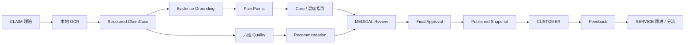

# 医护洞察：基于理赔医护记录的“医护洞察与温度指引”引擎

赛道四 / 课题 2 比赛原型。系统以已授权、已脱敏的理赔医疗材料为入口，完成本地 OCR、结构化病例、痛点识别、温度指引、案件级品质评价、就医推荐、医疗复核、正式发布和客户反馈闭环。

项目强调四个边界：**evidence-grounded**（结果可追溯到材料）、**human-in-the-loop**（关键字段与客户可见内容经医疗复核）、**安全门禁**（未通过审核不能发布）、**角色隔离**（不同角色只读取其职责所需信息）。

> 当前版本已完成比赛场景验证，后续可通过企业身份、安全基础设施和生产数据治理进一步扩展。

## 1. 核心能力

| 环节 | 当前实现 |
|---|---|
| 材料处理 | JPG/JPEG/PNG/BMP/WebP 本地 RapidOCR；逐页 OCR 修正、授权与脱敏确认 |
| 病例结构化 | `ClaimCase` JSON、字段状态/置信度/evidence、住院与费用一致性校验 |
| 长病例 | 自动 chunk、跨 chunk merge、冲突标记、缓存与失败恢复 |
| Evidence | OCR 页/文本/bbox 定位、实体和值绑定、检验视觉行校验 |
| 痛点识别 | clinical / cost / experience 三类规则与语义候选；逐条医疗复核 |
| 温度指引 | 个性化 Care Guide、分段修订、病例引用、医学边界安全检查 |
| Quality | 六维案件级评价；不可评分维度保持 `NOT_SCORED`，综合分由后端计算 |
| Recommendation | 医院、医生、治疗方向候选及可解释证据；支持医疗复核 |
| 医疗复核 | 结构化字段、Pain、Care、Quality、Recommendation 模块矩阵和最终审核 |
| 发布 | final approval 后形成客户可见正式快照；中间结果不会直接暴露给客户 |
| 客户与客服 | CUSTOMER 查看本人已发布结果并反馈；SERVICE 咨询、跟进和跨角色分流 |
| 角色待办 | `OPEN → PROCESSING → RESOLVED`，支持领取、脱敏联系方式预览和解决反馈 |

本项目面向医疗理赔后的客户服务场景，构建了一套基于大模型与医疗证据链的智能医护关怀闭环系统。系统通过本地OCR、医疗文本结构化、证据绑定、智能分析和人工审核，实现从医疗材料理解到患者关怀服务的全流程支持。项目创新性地引入Evidence Grounding机制，使AI生成结果均可追溯至原始医疗材料，提升医疗场景下的可信性与可解释性；同时结合规则引擎与大语言模型，实现临床、费用和服务体验多维痛点识别，并根据患者实际情况生成个性化温度指引。此外，系统建立医疗品质画像与服务推荐机制，通过安全门禁和角色权限控制保障医疗数据安全，实现“材料理解—需求洞察—关怀生成—审核发布—反馈跟进”的完整闭环，推动传统理赔服务向智能化、人性化和可信化方向升级。

## 2. 系统架构



系统包含四类正式角色：

- `CLAIM`：案件受理、材料、授权/脱敏、理赔状态和关怀交接；
- `MEDICAL`：字段复核、Pain/Care/Quality/Recommendation 复核和最终发布审批；
- `CUSTOMER`：创建/查看本人案件、读取正式发布结果和提交反馈；
- `SERVICE`：咨询登记、反馈跟进及向 CLAIM/MEDICAL 分流任务。

身份由后端 Session、RBAC 权限和 `case_participants` 案件关系共同确定，前端没有角色切换器。

## 3. 目录结构

```text
medical-track-task-4-2/
├─ src/medical_claims/       # 领域模型、OCR后处理、四问引擎、存储与评测
├─ web/backend/              # FastAPI 同源后端与安全环境变量模板
├─ web/dist/                 # 登录及 CLAIM/MEDICAL/CUSTOMER/SERVICE 静态页面
├─ scripts/                  # 启动、演示账号、真实 E2E、数据审计和转换脚本
├─ tests/                    # Python 与 Node 前端回归测试
├─ docs/                     # 数据库、工作流、脱敏、Gold 与第四问说明
├─ knowledge/                # Care 知识卡及经过约束的推荐能力数据
├─ evaluation/templates/     # Care 人工盲评模板
├─ examples/                 # 合成 ClaimCase 与 Pain Gold 模板
├─ outputs/                  # 本地数据库、OCR缓存、报告；被 Git 忽略
├─ pyproject.toml            # Python 与可选 API/dev 依赖
└─ DATABASE_OVERVIEW.md      # Schema Version 7 / 29 张表说明
```

`outputs/`、`.env`、缓存、日志和本地医疗材料不会随仓库提交。

## 4. 环境要求

- Python `>=3.11`（团队当前推荐 Python 3.12）；
- Windows PowerShell：仓库提供完整的一键启动脚本；
- macOS/Linux：可直接使用等价的 Python/uvicorn 命令；
- SQLite：使用 Python 标准库，无需单独安装数据库服务；
- Node.js：**运行系统不需要**；仅运行 `tests/*.test.cjs` 前端测试时需要；
- DeepSeek API Key：真实结构化及部分语义生成需要；本地 OCR 本身不需要；
- 网络：动态机构发现和 DeepSeek 调用需要，核心本地 OCR 与已缓存/规则能力不要求持续联网。

`.[api]` 会安装 FastAPI、Uvicorn、RapidOCR、ONNX Runtime、python-multipart、httpx、qrcode 和 python-dotenv。

## 5. 安装

### Windows PowerShell

```powershell
git clone https://github.com/aoliao12112/medical-track-task-4-2.git
Set-Location medical-track-task-4-2

py -3.12 -m venv .venv
& '.\.venv\Scripts\python.exe' -m pip install --upgrade pip
& '.\.venv\Scripts\python.exe' -m pip install -e '.[api,dev]'
```

如果没有 `py -3.12`，可使用任意已安装的 Python 3.11+：

```powershell
python -m venv .venv
& '.\.venv\Scripts\python.exe' -m pip install -e '.[api,dev]'
```

### macOS / Linux

```bash
git clone https://github.com/aoliao12112/medical-track-task-4-2.git
cd medical-track-task-4-2
python3 -m venv .venv
source .venv/bin/activate
python -m pip install -e '.[api,dev]'
```

## 6. 环境变量

仓库已提供安全模板：[web/backend/.env.example](web/backend/.env.example)。复制后只在本机填写，禁止提交真实 `.env`：

```powershell
Copy-Item '.\web\backend\.env.example' '.\web\backend\.env'
notepad '.\web\backend\.env'
```

macOS / Linux：

```bash
cp web/backend/.env.example web/backend/.env
${EDITOR:-vi} web/backend/.env
```

主要变量：

| 变量 | 用途 | 默认/要求 |
|---|---|---|
| `DEEPSEEK_API_KEY` | DeepSeek 鉴权 | 真实模型调用必填 |
| `DEEPSEEK_MODEL` | 模型名称 | `deepseek-flash` |
| `DEEPSEEK_TIMEOUT_SECONDS` | 单次请求超时 | `360` |
| `DEEPSEEK_MAX_RETRIES` | 传输错误重试次数 | `2` |
| `DEEPSEEK_*_MAX_OUTPUT_TOKENS` | 各生成环节输出上限 | 见 `.env.example` |
| `EXTERNAL_MODEL_PROCESSING_ENABLED` | 是否允许 Care/推荐意图调用外部模型 | `true` |
| `LONG_CASE_*` | 长病例阈值、分块和缓存 | 见 `.env.example` |
| `QUALITY_DYNAMIC_DISCOVERY_ENABLED` | 是否启用公开机构动态发现 | `true` |
| `QUALITY_SEARCH_PROVIDER` / `QUALITY_SEARCH_API_KEY` | 公开网页搜索提供方及可选 Key | `auto` / 空 |
| `MOBILE_PREVIEW_HOST` / `MOBILE_PREVIEW_GATEWAY_PORT` | 局域网只读手机预览 | 自动探测 / `8766` |
| `COMPETITION_DB_PATH` | 覆盖本地 SQLite 路径 | `outputs/competition.db` |
| `AUTH_SESSION_TTL_HOURS` / `AUTH_COOKIE_SECURE` | 本地 Session 时长和 Cookie 安全标志 | `12` / `false` |

本地数据库默认位于 `outputs/competition.db`，首次启动时自动应用 [database_migrations.py](src/medical_claims/database_migrations.py) 中的迁移。

## 7. 启动系统

### 推荐：同源角色门户与 API

在项目根目录运行：

```powershell
& '.\scripts\start_backend.ps1'
```

默认地址：

- 登录：<http://127.0.0.1:8000/login>
- CLAIM：<http://127.0.0.1:8000/claim>
- MEDICAL：<http://127.0.0.1:8000/medical>
- CUSTOMER：<http://127.0.0.1:8000/customer>
- SERVICE：<http://127.0.0.1:8000/service>
- 兼容工作台：<http://127.0.0.1:8000/legacy>
- API 文档：<http://127.0.0.1:8000/docs>
- 健康检查：<http://127.0.0.1:8000/api/health>

主角色门户依赖同源 Cookie 和相对路径 API。不要使用 `start_frontend.ps1` 占用 8765 来运行正式角色流程；它只保留给旧版静态调试。

### macOS / Linux 等价启动

```bash
PYTHONPATH=src .venv/bin/python -m uvicorn web.backend.app:app \
  --host 127.0.0.1 --port 8765 --env-file web/backend/.env
```

### 可选：手机只读预览

保持主门户运行，再打开一个 PowerShell：

```powershell
& '.\scripts\start_mobile_preview.ps1'
```

网关默认使用 `8766`，只提供令牌保护的客户预览，不暴露案件管理、OCR 或模型接口。仅在可信局域网使用。

## 8. Demo 账号与演示流程

仓库不保存明文密码。可用现有脚本幂等创建四个本地演示账号：

```powershell
$env:DEMO_USER_PASSWORD = '<自行设置的至少 8 位本地密码>'
& '.\.venv\Scripts\python.exe' '.\scripts\create_role_demo_users.py'
Remove-Item Env:DEMO_USER_PASSWORD
```

脚本中的真实用户名：

| 角色 | 用户名 |
|---|---|
| CLAIM | `demo_claim` |
| MEDICAL | `demo_medical` |
| SERVICE | `demo_service` |
| CUSTOMER | `demo_customer` |

脚本不会覆盖已有账号或密码。`scripts/seed_role_demo_flow.py` 只用于建立跨角色分流任务样例，**不能替代真实 OCR/结构化 Demo**。

流程：

1. CLAIM 登录并创建理赔案件；
2. 关联客户和医疗复核人员，确认材料已授权；
3. 上传已脱敏医疗图片，运行本地 OCR；
4. 人工核对 OCR、确认脱敏，生成结构化 `ClaimCase`；
5. MEDICAL 复核待确认结构化字段；
6. 生成并逐条复核 Pain；
7. 生成、修订和复核 Care，确认 safety gate 通过；
8. 生成并复核六维 Quality；
9. 生成并复核 Recommendation；
10. 在模块矩阵全部满足后执行 final approval 和 publish；
11. CUSTOMER 登录并查看正式发布结果、提交反馈；
12. SERVICE 查看反馈，领取/解决跟进任务，必要时分流给 CLAIM 或 MEDICAL。

最终审批不会自动发生；未通过字段复核、模块复核或安全门禁时不能发布。

## 9. Demo 输入数据

由于医疗隐私与合规要求，原始真实病例材料不随代码仓库公开。仅使用：

- 比赛官方提供的脱敏样例；
- 团队审核过的脱敏 Demo 图片；
- 自建的纯合成材料。

仓库包含：

- `examples/synthetic_001.json`：空白/合成 `ClaimCase` 示例；
- `examples/pain_gold.template.json`：Pain 专家标注模板；
- `evaluation/templates/care-ratings.template.json`：Care 人工盲评模板；
- 根目录 KR1 官方补充 ZIP：用于确定性转换官方 Gold，不应当作 Prediction；
- `knowledge/care_guides/`：Care 病种知识卡。

真实 E2E 可使用 [scripts/run_real_e2e.py](scripts/run_real_e2e.py)，但必须显式提供已授权、已脱敏图片：

```powershell
& '.\.venv\Scripts\python.exe' '.\scripts\run_real_e2e.py' `
  --images '.\path\to\deidentified-01.jpg' '.\path\to\deidentified-02.jpg' `
  --authorized --deidentified
```

结果写入被 Git 忽略的 `outputs/e2e/`。该脚本会创建本地案件并产生真实模型调用，不应用于无授权材料。

## 10. 预期输出

成功跑通主链路后可以看到：

- 带字段状态、置信度和 evidence 的结构化 `ClaimCase`；
- OCR 页、文本片段和可用 bbox 的来源定位；
- clinical / cost / experience 痛点及逐条复核结果；
- 可修订、有引用且通过安全检查的 Care Guide；
- 六维案件级 Quality、可评分覆盖率和后端综合分；
- 医院/医生/治疗方向推荐理由、来源和核验状态；
- MEDICAL 发布前模块矩阵；
- final approval 后的 CUSTOMER 正式快照；
- 客户反馈、SERVICE 跟进及跨角色 routed task 状态。

字段、工作流和数据库详情见：

- [DATABASE_OVERVIEW.md](DATABASE_OVERVIEW.md)
- [工作流合同](docs/WORKFLOW_CONTRACTS_V1.md)
- [OCR、脱敏和人工复核](docs/ocr-deidentification-workflow.md)

## 11. Evaluation / 比赛测评

所有评测结果默认写入本地 `outputs/`，该目录被 Git 忽略。当前 README 不公布尚未真实跑出的 F1、一致率或盲评分数。

### KR1：结构化字段 F1 与缺失率

正式 Gold 来源和转换边界见 [docs/official-kr1-gold.md](docs/official-kr1-gold.md)。首次准备 Gold：

```powershell
& '.\.venv\Scripts\python.exe' '.\scripts\convert_official_kr1_gold.py' --official-source-confirmed
```

转换后的正式路径：

```text
outputs/official_kr1_gold_v2/official-kr1.gold.final.json
```

准备由当前真实 pipeline 生成、且未读取 Gold 字段的 `outputs/prediction.json` 后运行：

```powershell
& '.\.venv\Scripts\python.exe' -m medical_claims.evaluation `
  '.\outputs\prediction.json' `
  '.\outputs\official_kr1_gold_v2\official-kr1.gold.final.json'
```

评测器按 `case_id` 对齐，列表实体做保守的一对一匹配，不按数组下标或跨病例池化。不要使用 `convert_official_kr1_gold.py` 或 `run_four_question_real_acceptance.py::seed_case()` 生成 Prediction。

### 测试

Python 测试：

```powershell
$env:PYTHONPATH = 'src'
& '.\.venv\Scripts\python.exe' -m pytest -q
```

前端测试不需要安装 npm 包，但需要本机已有 Node.js：

```powershell
node --test tests/frontend_hardening.test.cjs tests/medical_frontend.test.cjs `
  tests/customer_frontend.test.cjs tests/service_frontend.test.cjs
```

## 12. 安全与合规

当前原型实现的安全边界包括：

- 原始图片仅进入本地 RapidOCR；
- 外部模型只接收业务所需、经过授权和脱敏确认的 OCR 文本或结构化事实包；
- 敏感格式预警、人工脱敏确认和系统日志；
- evidence grounding 保留字段来源，失败字段进入人工复核；
- HttpOnly Session、RBAC 和 `case_participants` 案件范围校验；
- Pain/Care/Quality/Recommendation 分模块医疗复核；
- Care 医学边界、引用和知识卡安全检查；
- final approval 与发布快照不可由前端绕过；
- CUSTOMER 不读取原始 Pain、内部 Quality、evidence path 或审核调试信息；
- 不从费用清单商品规格推断 medication dose/frequency/route/duration；
- API Key、SQLite、OCR 缓存、日志和医疗材料均被排除在 Git 之外。

## 13. 已知限制

- 当前是本地 SQLite 比赛原型；企业 SSO、多设备会话和生产部署加固不在本项目范围；
- 后端直接支持图片，PDF/Word 需要先转换为图片；
- Quality 的用药合理性在剂量、频次、途径、疗程、过敏史或适应证不足时可能保持 `NOT_SCORED`；不得为提高 coverage 伪造分数；
- 医院/医生/治疗方案历史画像仍需真实样本覆盖、样本量展示和 KR4 gap analysis；
- 历史数据迁移模块采用渐进式校验策略，当前重点保障新增病例链路的数据一致性和证据完整性；
- 少数 Quality 文案可能仍有 HTML entity 显示清理需求，不影响后端审核门禁；

## 14. 比赛与技术材料

- [数据库结构说明](DATABASE_OVERVIEW.md)
- [比赛安全加固报告](COMPETITION_HARDENING_REPORT.md)
- [官方 KR1 Gold 说明](docs/official-kr1-gold.md)
- [工作流合同](docs/WORKFLOW_CONTRACTS_V1.md)
- [长病例验证说明](docs/long-case-validation-2026-10-01.md)
- [Pain 人工复核指南](docs/pain-point-review-guide.md)
- [Care 人工检查清单](docs/third-question-manual-checklist.md)
- [第四问品质画像说明](docs/fourth-question-quality-profile.md)
- [第四问机构覆盖审计](docs/fourth-question-provider-audit.md)
- [真实 E2E 验收清单](REAL_E2E_CHECKLIST.md)

私有团队交接、真实病例、日志、缓存和本地 evaluation 输出不作为公开比赛材料链接。

## 15. 快速复现步骤

按以下步骤即可在本地启动系统并复现主要演示流程：

1. 使用 Python 3.11+ 创建虚拟环境 `.venv`。

2. 安装项目依赖：

```powershell
& '.\.venv\Scripts\python.exe' -m pip install -e '.[api,dev]'
```

3. 根据 `web/backend/.env.example` 创建本地 `.env`，并按需配置 DeepSeek API Key。

4. 启动系统：

```powershell
& '.\scripts\start_backend.ps1'
```

5. 打开登录页：

```text
http://127.0.0.1:8000/login
```

6. 使用本地创建的演示角色账号登录。

7. 使用已授权、已脱敏的比赛样例或 Demo 输入材料。

8. 按以下流程完成完整演示：

```text
CLAIM
→ MEDICAL
→ Final Approval
→ Publish
→ CUSTOMER
→ SERVICE
```

9. 如需运行比赛评测，使用真实 Prediction 执行结构化、Pain 和 Care evaluation。

10. 评测结果和错误明细默认输出到 `outputs/`，该目录仅用于本地结果保存，不提交敏感内容。
