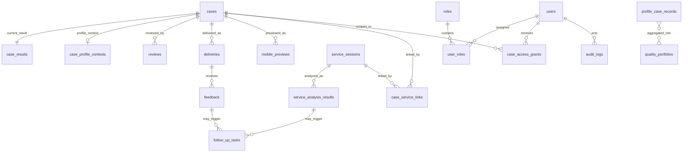

# 当前数据库结构

核查日期：2026-10-09。

项目使用 SQLite，默认文件为 `outputs/competition.db`，也可以通过
`COMPETITION_DB_PATH` 指定其他路径。`outputs/` 已被 Git 忽略，数据库不得提交到公开仓库。

## 表清单

| 业务线 | 表名 | 作用 |
|---|---|---|
| 理赔案件 | `cases` | 案件身份、授权、脱敏状态和工作流状态 |
| 理赔案件 | `case_results` | OCR、结构化病历、痛点和温度指引的当前快照 |
| 品质画像 | `case_profile_contexts` | 医院、医生、再入院和患者反馈等人工确认上下文 |
| 品质画像 | `profile_case_records` | 可进入画像计算的标准病例记录 |
| 品质画像 | `quality_portfolios` | 医院、医生和治疗方案的聚合画像 |
| 审核触达 | `reviews` | 人工审核记录 |
| 审核触达 | `deliveries` | 模拟触达记录 |
| 审核触达 | `mobile_previews` | 限时、只读、脱敏的手机预览快照 |
| 反馈闭环 | `feedback` | 用户对已触达内容的反馈 |
| 反馈闭环 | `follow_up_tasks` | 反馈、客服会话或人工创建的后续处理待办 |
| 客服洞察 | `service_sessions` | 脱敏客服会话，不保存原始用户身份字段 |
| 客服洞察 | `service_analysis_results` | 意图、摩擦、严重程度、证据和复核结果 |
| 客服洞察 | `case_service_links` | 会话与理赔案件的可信关联 |
| 角色权限 | `users` | 外部身份或演示账号映射，不保存密码 |
| 角色权限 | `roles` | 五类固定角色定义 |
| 角色权限 | `user_roles` | 用户与角色关联 |
| 角色权限 | `case_access_grants` | 用户可访问案件的范围授权 |
| 合规审计 | `audit_logs` | 查看、审核、触达和拒绝等敏感操作日志 |
| Schema | `schema_migrations` | 数据库结构版本记录 |

当前共 19 张表。

## 关系

## 角色、范围与审计

原型不保存密码。`users.external_subject` 用于对接企业统一身份，角色权限使用后端代码中的固定矩阵。

| 表 | 关键字段 | 说明 |
|---|---|---|
| `users` | `user_id`、`external_subject`、`display_name`、`identity_source`、`status` | 身份映射，不含密码、盐或密码哈希 |
| `roles` | `role_code`、`role_name`、`description` | 固定角色：用户、理赔客服、医学审核、运营、系统管理员 |
| `user_roles` | `user_id`、`role_code`、`assigned_by` | 一个用户可以拥有多个角色 |
| `case_access_grants` | `user_id`、`case_id`、`access_reason`、`expires_at` | 限定“可以访问哪一个案件”，用于用户本人和临时授权 |
| `audit_logs` | `actor_user_id`、`actor_role_code`、`action`、`resource_type`、`resource_id`、`result` | 记录允许、拒绝或错误的敏感操作，不保存原始IP，只允许保存不可逆哈希 |

系统管理员默认只有账号角色管理和审计元数据权限，不默认具有脱敏病历浏览权。前端隐藏不构成权限控制；API必须调用后端权限矩阵并同时检查案件范围。

脱敏确认也会写入 `audit_logs`。系统记录 `rule_clear` 或 `manual_override`、敏感格式命中类别
和修改版 OCR 文本指纹，不在审计表中重复保存完整 OCR 原文。保存新的 OCR 复核稿会将案件
脱敏状态重置为 `pending_review`，并清空旧的结构化、痛点、温度指引和画像上下文。

## 客服会话表

`service_sessions` 只接收已脱敏文本。

| 字段 | 说明 |
|---|---|
| `session_id_hash` | 安全散列后的会话编号，主键 |
| `channel` | `wechat`、`inbound_call`、`online` 等渠道 |
| `session_time` | 会话发生时间 |
| `deidentified_text` | 脱敏后的会话文本，可空 |
| `text_fingerprint` | 内容指纹，用于去重和变更识别 |
| `data_source` | 数据来源声明 |
| `consent_status` | 授权状态 |
| `deidentification_status` | 脱敏确认状态 |
| `created_at` / `updated_at` | 创建和更新时间 |

禁止在该表加入原始 `oneid`、`account_id`、企微 ID、手机号、身份证号或姓名。

## 客服分析表

`service_analysis_results` 将“咨询意图”和“真实服务摩擦”分开保存。

| 字段 | 说明 |
|---|---|
| `analysis_id` | 分析编号，主键 |
| `session_id_hash` | 关联脱敏客服会话 |
| `primary_intent` / `secondary_intents_json` | 一级和二级咨询意图 |
| `has_friction` | 是否存在明确服务摩擦，只能为 0 或 1 |
| `friction_types_json` | 催促、报错、异议、未收到等摩擦类型 |
| `severity` / `severity_score` | 严重程度与 0–100 分数 |
| `confidence` | 0–1 置信度 |
| `evidence_json` | 脱敏证据定位 |
| `recommended_action` | 解释、转人工或工单建议 |
| `engine_version` | 分析引擎版本 |
| `review_status` / `reviewer` | 人工复核状态与脱敏复核人 |
| `analysis_json` | 完整分析结果 |
| `created_at` | 分析时间 |

## 通用待办表

`follow_up_tasks` 已从“只能由反馈产生”升级为通用来源。

| 字段 | 说明 |
|---|---|
| `task_id` | 待办编号，主键 |
| `case_id` | 可选的理赔案件关联 |
| `feedback_id` | 反馈来源时填写 |
| `service_analysis_id` | 客服会话分析来源时填写 |
| `source_type` | `delivery_feedback`、`service_session` 或 `manual` |
| `category` | 费用、材料、进度、保障规则、增值服务等类别 |
| `priority` | `low`、`medium`、`high`、`urgent` |
| `status` | `OPEN`、`PROCESSING`、`RESOLVED`、`CLOSED` |
| `assignee` | 可选的处理人或处理组 |
| `note` | 产生待办的原因 |
| `record_json` | 完整待办对象 |
| `created_at` / `resolved_at` | 创建和解决时间 |
| `resolution` | 处理结果 |

数据库约束保证反馈来源和客服会话来源不会同时填写，也不会冒充人工待办。

## Schema 版本

| 版本 | 名称 |
|---:|---|
| 1 | `initial_competition_schema` |
| 2 | `add_mobile_previews` |
| 3 | `add_service_analysis_tables` |
| 4 | `generalize_follow_up_sources` |
| 5 | `add_role_scope_and_audit_tables` |

启动 `CaseStorage` 时会创建缺失表，并将旧版反馈专用待办表兼容升级为新版结构。
